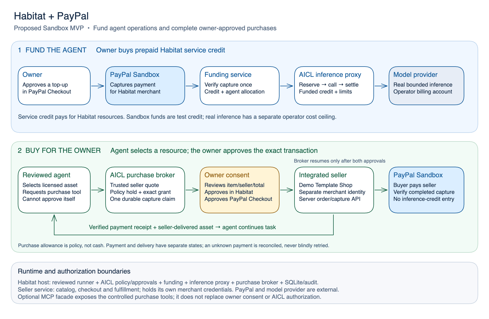

# Agent purchases through PayPal

Status: proposed implementation design, October 19, 2026. Agent purchases and
[PayPal funding for inference](../paypal-funding/spec.md) are both core capabilities
of the revised PayPal hackathon MVP. Neither payment integration nor real inference
is implemented in the current E11 prototype. This document supersedes the earlier
decision to defer purchases.

## Product decision

The agent should be able to buy a useful resource for its owner: select an offer,
explain its purpose, request approval, initiate checkout, and complete and verify
the approved purchase through a controlled tool. The owner remains in control of
the seller, item, total, and payment consent. The agent receives a receipt and the
purchased resource so it can continue the task.

For the first demo, the reviewed marketing agent builds a launch kit and purchases
an owned/licensed digital template from one integrated **Demo Template Shop**
Sandbox merchant. Use a separate merchant identity from Habitat's funding account.
The agent chooses the catalog offer; the merchant supplies its authoritative price
and fulfillment. No arbitrary web shopping, physical shipping, recurring charge,
gift-card purchase, or live advertising purchase is required for this slice.

The seller adapter is a real integration boundary. Habitat cannot create a PayPal
order under its own merchant account and claim that an unrelated shop has been
paid. The demonstration uses a controlled seller with a known catalog, checkout
API, and delivery endpoint. It proves the full purchase path for that seller;
additional merchants require their own supported integration.

## PayPal has two roles

| Capability | Payment destination | What AICL controls | What the owner sees |
| --- | --- | --- | --- |
| Fund the agent's operation | Habitat merchant | Prepaid service credit, allocation, inference reservations and measured charges | Service credit: available, reserved, used |
| Buy a resource for the owner | Integrated seller | Allowed merchant/items, purchase quota, exact approval, capture claim and receipt | Purchase allowance, proposed total, external payment and delivery status |

Purchase allowance is a **policy ceiling**, not stored money or the owner's PayPal
balance. Increasing it never funds a purchase. The buyer chooses a funding method
inside PayPal Checkout. A merchant purchase does not debit Habitat service credit;
a purchase refund does not mint inference credit. Inference used to plan the
purchase or consume its output still draws from the agent's funded allocation.

Example demo values: $5 of Habitat service credit, a separate $2 purchase limit,
and a $1 digital template. These are test amounts. Sandbox purchases move no real
money; real model calls remain subject to the operator's real-cost ceiling.

[Editable diagram](diagrams/paypal-funding-and-purchases.excalidraw)

## Owner and agent journey

1. The owner funds and allocates inference credit, enables `purchase`, allows the
   demo seller, and sets per-purchase and daily/monthly purchase limits.
2. The agent uses inference to plan the launch kit and selects a catalog offer.
   The server obtains a trusted quote including merchant, item/version, quantity,
   all-in USD total, license, fulfillment destination, and expiry.
3. The agent requests approval with a short reason. Habitat shows **Review
   purchase** with that exact transaction and its separate payment source. The
   owner's approval authorizes only this immutable quote and expires with it.
4. The broker creates one matching seller order and shows **Continue to PayPal**.
   The owner signs in to Sandbox buyer checkout, selects the funding source, and
   approves payment. Habitat approval and PayPal buyer consent are both required.
5. On return, the broker rechecks current authority and verifies the bound order,
   then claims and captures that same order. The agent may request continuation,
   but cannot approve itself, substitute a payee or amount, or access credentials.
6. Habitat verifies completed capture, records external purchase spend once, and
   shows the payment receipt. It separately verifies seller fulfillment and makes
   the purchased template available to the agent as untrusted task data.
7. The agent uses the asset to finish the launch kit. Activity links the proposal,
   approval, payment receipt, delivered asset, model usage, and resulting output.

The owner may decline or cancel before the capture claim. A new item, seller,
quantity, total, license, recipient, or expired quote requires a fresh approval.
A purchase limit is not blanket consent for purchases below that limit. A claim
already committed may complete after pause/revocation; those controls cannot undo
an external payment. The UI must explain that boundary when a payment is in flight.

## What PayPal supports

The standard Orders flow lets the seller create an order, the buyer approve it,
and the seller capture it. It does not give Habitat or its agent unrestricted
authority over a buyer's wallet. This is the selected MVP integration.
[Orders integration](https://developer.paypal.com/api/rest/integration/orders-api)

PayPal's agent tools expose order operations, including `pay_order` for capture.
Putting that operation behind MCP does not supply missing buyer consent or merchant
access. The broker must enforce the same checks whether it calls REST directly or
uses an official PayPal tool internally.
[Agent tools](https://developer.paypal.com/ai-tools/agent-tools/),
[MCP server](https://developer.paypal.com/ai-tools/mcp-server)

PayPal's WebMCP description also places product selection and checkout initiation
with the agent, followed by human review and approval in PayPal. Merchant/browser
enablement must be verified before adopting that transport. The documented remote
MCP commerce catalog currently focuses on gift cards; it is not evidence of
universal merchant shopping. Neither evolving path is a dependency of this demo.
[WebMCP guidance](https://developer.paypal.com/community/blog/WebMCP_PayPal_Agent_Ready/),
[commerce tools](https://developer.paypal.com/community/blog/expanding-paypal-mcp-capabilities/)

## Agent tool surface

Expose a narrow `purchase` tool family through the reviewed runner contract:

| Tool | Result and authority |
| --- | --- |
| `purchase.quote(merchant_ref, offer_id, quantity)` | Server obtains a trusted quote for an allowlisted offer |
| `purchase.request_approval(quote_id, purpose, request_id)` | Reserves policy allowance and creates an owner review request |
| `purchase.execute(purchase_id)` | Resumes the existing purchase; returns approval/checkout required until both are satisfied |
| `purchase.status(purchase_id)` | Safe payment, delivery, and receipt projection |
| `purchase.cancel(purchase_id)` | Stops an unclaimed operation when nonexecution is established; cannot reverse a completed or uncertain payment |

An MCP server is **optional** for the first internal agent. A thin MCP facade is
useful when another runner needs the same tools; it delegates to the AICL purchase
broker. It is not the authorization layer. Do not expose unrestricted PayPal
capture, refund, payout, vaulting, or account tools to the agent.

## Interface and failure behavior

Keep **Service credit** and **Purchase allowance** visibly separate on the agent
page. A purchase card shows seller, item, exact total, purpose, expiry, license,
Sandbox label, and **Review / Decline**. Approval leads to **Continue to PayPal**.
Payment states and delivery states remain distinct: **Paid — awaiting delivery**
is different from **Ready to use**.

Cancelled or declined proposals make no payment. A timeout shows **Verifying
payment**, retains the policy hold, and reconciles the same order. Do not invite
the owner to create a new order while the outcome is unknown. A failed asset
delivery after payment shows **Paid — delivery needs attention** and retries only
delivery; it must never repeat the purchase. A verified refund updates the receipt
and refund total without automatically creating new purchase authority.

## Required demo and implementation slices

1. Quote, policy hold, exact owner approval, and safe agent tools against a local
   merchant fake, including denial of changed/unapproved transactions.
2. A separate integrated Sandbox merchant with one owned/licensed digital item,
   buyer checkout, stable create/capture identities, and verified receipt.
3. Durable reconciliation and delivery recovery; duplicate calls cannot buy twice.
4. One funded real agent run that proposes the purchase, pauses for the owner,
   receives the paid resource, and uses it in the final output.
5. UI and three-minute demo showing both payment roles and a refusal before any
   unauthorized purchase is attempted.

Purchases are required for the revised complete hackathon demonstration. Funding
and real inference can be built first, but are only an intermediate slice.
[Technical contracts](technical.md) and the [demo script](../../hackathon-demo-script.md)
define the implementation and presentation details.
