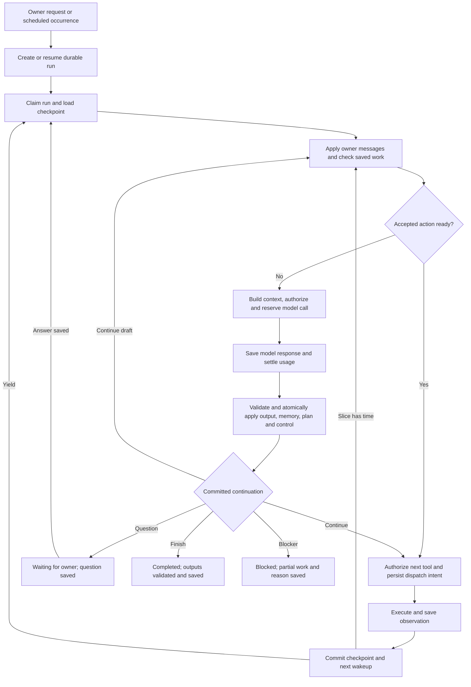

# Durable execution for general agents

Status: runtime core and opt-in local chat integration implemented, October 26, 2026.
Durable agent sessions are the active implementation priority. The design below
also covers later integration work; the implemented boundary is recorded here.
The scheduled worker retains its existing path. Local chat can now address a
durable run when explicitly enabled; [General agents](../general-agents.md)
describes both paths.

The [encrypted storage implementation plan](../plan/encrypted-agent-storage.md)
is saved for the production release. Its implementation, KMS integration and reset
are not prerequisites for the first durable-session proof. Use disposable public
or synthetic data for this nonproduction work.

Keep a small, scoped content repository with opaque versioned references between
the runtime and persistence. Start with a SQLite adapter; later replace its content
implementation with the encrypted store. Preserve authenticated tenant/run scope,
atomic checkpoint publication and replay identity now. The production storage and
confidentiality target remains in [Agent data and trust](agent-data-trust.md).

## Implemented runtime core

`backend/aicl/agent_runtime/` provides a Python service for creating a run,
advancing a bounded slice, recording a receipt, sending owner direction,
answering a question, and pausing, resuming or cancelling work. Scripted adapters
support deterministic proofs. The opt-in local composition adds a real structured
decision adapter, a bounded public-page reader and an opt-in hosted search tool
in development/test. Current shared-workspace controls and restart behavior are
described in [the workspace design](unified-agent-workspace.md).

One versioned JSON decision can update the plan, derived working notes and
multiple artifacts, then request a bounded batch of independent reads, continue
drafting, ask the owner, finish or block. The whole decision is validated before
its local changes are committed together. Owner requirements remain immutable to
model proposals. Completion requires every requirement assessment, existing
outputs and a completed or superseded plan; these are structural checks, not
independent verification of the model's conclusions.

SQLite migrations `0032` and `0033` add scoped immutable content, runs, steps,
events, wakeups and runtime hold ownership. Plan, memory and artifact-version
references live in the checkpoint. Each dispatched step currently represents
one actual attempt; retry orchestration is not enabled. Receipt persistence and
usage settlement precede checkpoint application, so failed application can reuse
the receipt without another model or tool call. Leases and fences protect worker
ownership; uncertain dispatches retain reservations and block automatic resend.

The runtime uses the existing instance budgets, service credit and canonical
usage ledger. Shared provider totals include legacy inference, Render and runtime
holds/usage once; unrelated simulated work does not consume the provider ceiling.
The legacy hold reconciler excludes runtime-owned holds. Known malformed results
still settle known usage, and overruns prevent further dispatch.

Efficiency checks cover shared evidence across outputs, same-run fresh read reuse,
bounded context with scoped artifact retrieval, and persisted decision/action/
draft limits. The restart acceptance test launches a separate Python process:
the remaining accepted read executes with **zero additional model calls**. Other
checks cover saved-receipt recovery, unknown outcomes, atomic invalid-envelope
rejection, tenant/run isolation, owner steering and questions, and repeated work.

Run the disposable synthetic demonstration from the application directory:

```sh
PYTHONPATH=backend .venv/bin/python -m aicl.agent_runtime.demo
```

It completes two outputs with three scripted model calls and two fixture reads,
including an owner question and answer. Its temporary database is removed on exit;
it makes no network requests. Focused verification:

```sh
PYTHONPATH=backend .venv/bin/python -m pytest backend/tests/unit/test_agent_runtime_contracts.py backend/tests/integration/test_agent_runtime_storage.py backend/tests/integration/test_agent_runtime_session.py backend/tests/integration/test_runtime_accounting.py -q
```

## Test through local chat

The existing local launcher now accepts an explicit runtime switch:

```sh
PYTHONPATH=backend .venv/bin/python -m aicl.demo_server --chat openai --agent-runtime openai
```

The launcher defaults to `--entry private-link`: the home page stays locked until
the private local link is opened, then the existing email-entry form establishes
the owner session without sending mail. This loopback-only profile keeps mock
payments and disables the test sign-in endpoints; it does not enable the hosted
judge or production profile. The launcher saves an owner-only (mode `0600`)
`<database filename>.private-access-token` and `.private-access-url` beside the
database. It reuses the token across restarts, updates the saved URL for the
selected port, and prints only the URL file's path. Access logging is disabled
because the link contains a credential. Invalid or insecure existing entry files
fail startup without exposing their contents. Use `--entry email` explicitly to
restore the captured-email test flow.

Supply `OPENAI_API_KEY` in the environment, or add
`--inference-key-file /absolute/path/to/credentials.env`. The file is read literally
and never executed. The equivalent app setting is `AICL_AGENT_RUNTIME_MODE=openai`
with `AICL_CHAT_MODEL_MODE=openai`. The runtime defaults to `off` and rejects
production or Render execution profiles. This command enables paid model calls;
the setup assistant's allowance remains separate from the agent worker's existing
instance budgets, service credit and persistent inference ceiling.

In `/chat`, create/review a general agent or select an existing one under **Start
work**. Chat shows available service credit and the next operation's bounded
estimate before allowing start or resume. Use **Add funds with PayPal** to review
and authorize a top-up, then return to the same conversation and selected agent.
An unfinished payment offers **Continue payment** so its outcome can be resolved
before another top-up. Payment never starts or resumes work automatically.
Set positive resource limits through **Review spending limits and controls**.
Leave its schedule paused, then start the interactive session.
Starting a draft may activate it through the existing owner lifecycle operation;
an owner-paused instance still needs explicit resumption in its controls.
The run snapshots the saved objective, supplied context and every output's
criteria. Its progress, working plan, owner question, replies and versioned outputs
appear in the chat. Ordinary steering and answers go directly to the run, with no
setup-assistant inference. Pause/resume/cancel remain deterministic owner actions.

The local worker drains durable wakeups while the server is running. It renews
ownership between operations, executes bounded slices and releases workers on
waits. Restarting the same database discovers queued work and expired leases.
Late receipts settle against their original operation; a verified no-charge
rejection can resolve an uncertain reservation. Unknown outcomes still block
automatic resend. Server downtime stops execution until restart; the browser does
not drive the worker.

The model adapter returns the full decision envelope using a strict per-tool
schema, pins the existing model price version, bounds request/response size and
total request duration, and disables automatic retries and provider tool execution.
It retains response identity and known usage even when the decision is unusable.
Rejected replies retain a bounded validation stage, code and known field path,
without raw model output, rejected values or exception text. The coordinator
revalidates this diagnostic before supplying it to the existing bounded retry.
Invalid replies apply no plan, artifact or tool changes; continuing uses saved
research and preserves cumulative usage and invalid-decision counters.
The implementation follows the [Structured Outputs contract](https://developers.openai.com/api/docs/guides/structured-outputs).

`web.read` reads public HTTPS HTML/text without running JavaScript, restoring
cookies or calling another model. The owner must select it for the run; the
instance also needs `network.fetch` and exact approved domains. Every redirect
rechecks current access, and DNS results must be public and are pinned for the
connection. Results retain observation time, source text, links and truncation.
`artifact.read` retrieves bounded saved excerpts within the same run. `web.search`
uses a separate `network.search` grant and a discrete priced request with one
hosted action, a bounded query/result and a total transport deadline. It reuses
the existing provider usage parser and preserves uncertain holds. It discovers
sources without granting direct page reads or requiring a domain list. Its
168k-input reservation remains the existing conservative estimate, not a strict
aggregate provider-token guarantee; overruns settle actual usage and quarantine
further dispatch. Rendered browser view is not exposed in this composition.

Migration `0034` links an authenticated chat to one run and retains provider
receipt metadata. Active durable work excludes legacy schedule admission,
inference and Render enqueue for that instance, even if the configuration's
scenario changes. The legacy scheduler has not been routed into the new runtime.

Still to implement: a guaranteed aggregate provider-cost bound for hosted search,
rendered browser view, Render slices, integration with the existing
owner inbox and output-review workflow, owner requirement amendments and linked
revision runs. Content remains plaintext SQLite for nonproduction; encrypted
storage and production controls remain deferred as agreed. Automated provider
tests use mocked transports; they are not paid-provider quality evidence.

## Recommendation

Build a small, application-owned coordinator around the existing control plane,
database and Render workers. A run repeatedly decides, acts, saves the result and
continues. The goal, working plan, observations, outputs and limits survive worker
restarts and owner conversations. Begin with one action in flight per run, but
allow one model decision to supply several independent actions. Serial execution
does not require a model call between tools.

The unit of execution is **one objective or scheduled occurrence, containing all
its outputs**. Multiple outputs share research and working state. A topic, source
list or report format belongs in the agent's instructions, not in runtime code.

A **durable agent session** is this run and its saved definition snapshot, plan,
steps/attempts, artifacts and owner conversation. It spans many model decisions,
tool calls and worker lifetimes. Resuming a session continues the same run; it does
not create a new run for every message or output.

Use the existing Responses integration behind a new single-decision interface.
Keep Habitat authoritative for execution state, authorization and accounting.
This lets us deliver a useful vertical slice without replacing the scheduler,
budget ledger, owner inbox or deployment stack.

## What changes from today

| Current implementation | Proposed behavior |
| --- | --- |
| `workflow/service.py` creates a job for each configured output | One general run owns the occurrence and all expected outputs |
| `openai_inference.py` expects a finished deliverable or clarification after one response | A decision may request another tool action, ask the owner, save work, finish or report a blocker |
| Search metadata is retained with an output | Source observations are saved and reusable throughout the run |
| `workflow_inference_attempt.version` mixes model calls, questions and output revisions, with a limit of 12 | Step sequence, dispatch attempts, plan revisions and artifact versions have separate identities |
| Owner answers lead to regeneration with the saved brief and answers | Answers resume the same run at its checkpoint, retaining completed research |
| Render caches an inference result but has no general continuation checkpoint | Workers claim bounded slices of a persistent run, then yield and enqueue continuation |
| Any inflight/unknown inference attempt blocks inference globally | Per-run ownership prevents conflicting execution; shared budgets remain atomically enforced |

Keep the existing demo and purchase workflows on their current paths. Route new
general runs through the new runtime behind an explicit configuration switch.
Historical attempts, holds and outputs retain their existing identities.

## Work model and planning

An **agent definition** stores a reusable objective, inputs, expected outputs,
criteria, tool grants, resource limits and optional schedule. A **run** snapshots
that definition for one occurrence. Owner steering is an ordered amendment to that
run; it does not silently rewrite future occurrences.

Keep required outputs and owner success criteria in a separately versioned
requirements snapshot, with the original objective and authenticated owner
amendments. The model may change its plan decomposition and item-level checks,
but `plan_patch` cannot remove or weaken owner requirements. Completion checks
all currently effective owner requirements, including any with no remaining plan
item. Model-generated notes or assumptions cannot act as owner amendments.

A **plan item** describes an outcome, such as inspecting sources or comparing
alternatives. An **execution step** records a concrete model decision or tool
operation. One item can require many steps. A **dispatch attempt** records one
actual provider request, including retries and its cost. An **artifact version**
records saved evidence, a draft or a final output.

The first model decision proposes a short plan and its next action or bounded
group of independent actions together. There is no mandatory extra planner call
before every action. A simple request can finish in that first decision without
creating artificial research or review phases. Plan items contain:

- Stable ID, title and success criteria.
- Dependency IDs and state: `pending`, `active`, `completed`, `blocked`,
  `failed` or `superseded`.
- Evidence/output references and a concise result or blocker.

Store the small plan as versioned checkpoint content through the scoped repository;
a task table and parallel graph scheduler are unnecessary for serial execution.
Validate IDs, dependencies, cycles and patches against the expected plan version. Replan when
new evidence, owner direction or a blocker warrants it, preserving completed work
and the reason for changes. A plan cannot add permissions or increase limits.

Completion is evidence-based: required artifacts must exist, references must be
valid, and each criterion must have a recorded assessment. Separate deterministic
checks from model self-assessment. A model's claim of completion is not independent
fact verification. Owner acceptance remains separate from execution completion.

## The loop



### One structured response carries all useful updates

Every successful model decision returns a versioned JSON envelope. Output, working
memory, plan changes and actions are independent fields, so the same inference can
produce all of them. Only the requested continuation is mutually exclusive:

```text
decide(context) -> DecisionEnvelope {
  schema_version: 1,
  output: {
    message: string | null,
    artifacts: [{local_ref, content, evidence_refs, ...}]
  },
  memory_updates: [{op, key, kind, text?, evidence_refs}],
  plan_patch: PlanPatch | null,
  actions: [{name, arguments, plan_item_id?}],
  control:
    {next: "continue"}
    | {next: "continue_draft", requirement_ids, reason}
    | {next: "wait_owner", question, options?}
    | {next: "complete", artifact_refs, criterion_assessments}
    | {next: "blocked", reason, partial_artifact_refs}
}
```

This is a logical contract; each variant needs a strict JSON schema with explicit
field and payload bounds. Unused collections are empty and absent patches/messages
are null; do not force the model to generate a progress message or rewrite unchanged
memory on every turn. The server binds tenant/run identity, decision ID, checkpoint
version and consumed owner-message cursor from the invocation snapshot. Those
values are not authority supplied by model JSON.

| Field | Meaning and application |
| --- | --- |
| `output` | Optional owner-visible message and zero or more artifact drafts/outputs; persist once and render from the saved record |
| `memory_updates` | Small changes to the run's working notes, with evidence references and explicit uncertainty; no separate memory-writer call |
| `plan_patch` | Changes to plan decomposition, item-level checks or progress justified by known evidence; cannot edit owner-required outputs or criteria |
| `actions` | Bounded tool requests with known arguments; each receives its own dispatch identity, controls and result |
| `control` | Proposed continuation, owner wait, completion or blocker; server checks the transition against persisted state |

An envelope can save a partial answer, remember a finding, update the plan and
request more reads together. A final envelope can save multiple outputs and memory
updates while completing the run. `output` means content inside the run/UI; it
does not authorize email, publishing or another external effect. Those require
separately authorized tools.

Enforce these combinations in code:

- `continue` requires a nonempty action list. This avoids plan-only or memory-only
  self-loops that consume inference without obtaining new evidence.
- `continue_draft` has no actions and must commit a substantive artifact chunk or
  revision, reference unmet owner requirements and state why another decision is
  needed. This supports long writing/analysis from existing evidence without
  artificial tool calls. A separate persisted continuation cap, ordinary inference
  budget and no-progress checks apply. A memory/plan-only edit or repeated unchanged
  draft does not qualify. Record append/version semantics so recovery cannot
  duplicate a chunk; the model cannot raise the continuation cap.
- `wait_owner` saves one explicit question and has no action list. Drafts and
  memory updates may accompany it, but dispatch waits for the answer.
- `complete` has no actions, outstanding required work, unresolved question or
  uncertain attempt. Its referenced outputs and criterion assessments must pass
  completion checks against the effective owner requirements, not merely the
  current plan items. Local artifact references may point to content created in
  this same envelope, resolved by the server in its application transaction.
- `blocked` has a reason and no actions; it may retain partial outputs and notes.

With pending actions, outputs remain draft/partial and cannot claim those actions
succeeded. Memory and plan updates may use existing evidence, not imagined future
tool results. A tool's eventual success is recorded from its receipt, never from
the model's proposed action list. Asking a question or claiming completion in free
text does not change lifecycle state; only a valid `control` transition does.

### Apply once, then execute

Save the provider response/usage receipt first. Validate the whole envelope's
structure, references, scope, version preconditions, action eligibility and
control/field combinations before applying any proposed update. In one local
transaction, apply memory/plan patches, create artifact versions and owner-visible
events, persist accepted action intents, set the requested lifecycle/wakeup and
record the decision as applied. Deterministically map decision/local references to
stored IDs so replay cannot duplicate notes, outputs, questions or actions.

External tool execution happens after this commit and is not part of that atomic
transaction. Reauthorize and reserve each action at dispatch as described below.
If local application fails, recovery retries the saved envelope rather than asking
the model to reconstruct it. If owner direction or state preconditions changed,
retain the response but supersede its unaccepted updates for reconsideration;
never partially apply a stale envelope.

Check checkpoint, requirements and owner-message versions inside the same write
transaction that applies the envelope. Lease renewals and receipt/accounting
bookkeeping have separate revisions; they must not invalidate otherwise current
model work. Meaningful owner direction or changed requirements must invalidate it.

Schema enforcement is not a guarantee that every provider request returns a usable
decision. Refusals, truncation and invalid envelopes are recorded adapter outcomes
with normal usage settlement and bounded recovery, not executable partial JSON.
Do not execute streamed fields before the entire envelope is complete and valid.

The first adapter uses structured JSON decisions with provider-hosted tools
disabled in `decide()`. Habitat dispatches the requested operation through its
tool registry. For `continue`, `actions` contains one or a server-bounded number of
fully specified calls; it is not a program or an unbounded graph. Hosted web research,
when available, is a separately authorized and reserved tool attempt; it is not
silently performed inside a planning call.
This extends the existing structured-output approach with a new envelope schema;
it requires adapter and coordinator changes.

Internal artifact tools retrieve earlier findings and can support content too
large for the envelope. Routine bounded artifact writes use `output.artifacts`
directly, avoiding an extra tool request and model round trip just to save a draft.
Strict schemas, bounded payloads and server-side validation apply to all actions.
The model proposes transitions; the coordinator decides which are valid.

### Execute known work without another decision

Separate **model decisions**, **tool actions** and **durable checkpoints**. A single
decision can request several independent actions. Each action still receives its
own authorization, reservation, receipt and checkpoint. Saving progress, settling
usage, applying recorded results and selecting the next accepted action are code,
not model calls. The initial executor remains serial within a run.

For multi-action decisions, all arguments must already be known and no action may
depend on an earlier action's result. The tool registry marks eligible independent
read operations; stateful browser interactions and external writes are not eligible
for these batches. A single call remains valid for any otherwise available tool.
Do not allow result placeholders, model-written scripts or a speculative decision
tree in this first contract. When results determine the next action, return those
results to the model together and ask for one new decision.

Validate the entire action list's schemas, tool versions, size bounds and batching
eligibility before dispatching any member. Reject a structurally invalid batch
without partially executing it; save and account for its model response normally.

Persist the accepted action list, originating decision ID, owner-message cursor
and next-action position. Derive stable child step IDs from the accepted decision
and action ordinal. Recheck owner events, authority, budgets and the worker fence
before each dispatch; accepting a batch does not preauthorize all its effects or
charge for undispatched actions. New owner direction invalidates the remaining
unstarted actions for reconsideration. A pause, cancellation, permission denial,
unknown outcome or exhausted limit stops dispatch at that boundary.

Known resolved failures may become bounded error observations while other
independent reads continue. Adapter-defined transient retries remain bounded and
recorded without a mandatory model call. Unknown billable outcomes still require
reconciliation. On restart, apply saved receipts and resume the pending list;
neither regenerate the decision nor rerun recorded successes. If the worker slice
ends partway through a batch, persist its position and continue in the next slice.

This is batching to reduce model round trips. Parallel dispatch is a separate,
deferred optimization. Neither requires a new agent per action. Continue until
completion, a genuine wait, cancellation or a cumulative limit.

Provider-hosted search is a separate durability boundary: one Responses request
can contain provider-managed activity. Habitat can checkpoint that request's
result, not every internal search/open event. Describe it honestly as one bounded
research operation. Application-owned page reads and browser observations get
their own checkpoints. Do not represent a hosted trace as separately recoverable
tool execution.

Research results distinguish provider-synthesized findings and citation metadata
from captured source text. A citation URL does not mean the underlying page was
saved; subsequent page reads retain their own source excerpts and provenance.

## State and storage

Use the existing persistent database, owned by the control-plane service. Remote
workers use scoped APIs; they do not share or mount the SQLite file. All rows and
artifact lookups are tenant/instance scoped from authenticated context.

| Proposed record | Responsibility |
| --- | --- |
| `agent_run` | Goal/config and owner-requirements versions, occurrence or request identity, parent revision run, status/reason, current plan/checkpoint, owner-message cursor, cumulative limits, state version, lease owner/expiry/fence |
| `agent_step` | Ordered model decision or tool action, originating decision/action ordinal, associated plan item, input/output references and execution state; decisions retain their versioned envelope/application status and pending action list |
| `agent_attempt` | Actual dispatch identity and input digest, adapter/version, effect/retry class, authorization snapshot, hold ID, provider ID, receipt, usage and uncertainty |
| `agent_artifact` | Versioned observations, drafts, outputs and context summaries; retained content or durable blob reference, hash, provenance and timestamps |
| `agent_event` | Ordered owner messages and execution/progress events with deduplication keys; plan changes and applied-message cursor remain traceable |
| `agent_wakeup` | Transactional outbox plus worker-slice identity, availability time, delivery state, backend task identity and compute hold/receipt linkage |

Enforce unique run admission by instance and trigger identity: a scheduled due
time, owner request key or revision request key. Replayed admission returns the
same run; changed input under the same key conflicts. Enforce step sequence within
a run and deduplicate dispatches, receipts and owner messages by their own IDs.

Admission is shared across the legacy and general engines. One router/trigger
record selects and pins the engine at first admission; a configuration change or
second scheduler cannot admit the same occurrence once in each engine. New-table
uniqueness alone does not protect against existing legacy occurrence records.

The current-state rows are authoritative for execution. The event journal explains
changes; it is not a second orchestration engine. Reuse canonical budget holds,
usage and audit records rather than inventing another ledger. Existing security
audit payloads remain compact; source content and model history belong in the
artifact/event store. Large screenshots require durable blob storage; a worker's
temporary filesystem is not a checkpoint.

Definition snapshots, plan text, owner messages, URLs and result bodies use opaque
content references resolved by a scoped repository. The initial nonproduction
SQLite adapter may store these payloads as ordinary TEXT/JSON. Publish content and
its parent/checkpoint reference in the same transaction, and avoid direct payload
SQL in the coordinator or tool adapters. An ID alone never grants access.

For production, these references resolve through the encrypted content store, with
explicit resource/purpose grants and context/disclosure policy enforcement as
defined in the trust design. Those confidentiality controls are deferred work;
the initial adapter does not provide encrypted content storage. Existing tenant
checks, owner authority, brokered secrets and per-dispatch budget controls remain
required throughout the runtime work.

Run lifecycle:

| State | Meaning and next transition |
| --- | --- |
| `queued` | Eligible now or at a saved wake time; worker can claim it |
| `running` | One current lease holder is advancing the run |
| `waiting_owner` | Durable question or approval request; matching answer queues the run |
| `waiting_external` | A known asynchronous operation is pending; reconcile its identity |
| `blocked` | Budget, permission, context, repeated lack of progress or unknown outcome needs resolution; reason determines the allowed resume action |
| `paused` | Owner explicitly paused execution; owner resumes it |
| `completed` | Required outputs and completion checks are recorded |
| `failed` | Terminal known failure, with explanation and preserved partial work |
| `cancelled` | Owner stopped this run; late receipts can still settle |

Yielding returns to `queued`, with the same run ID and checkpoint. A partial output
at a limit does not make the objective completed. Missing transport confirmation
does not make an operation failed. Budget counters and unresolved holds survive
every transition, restart and owner reply.

## Transactions, worker ownership and recovery

1. Claim an eligible run by compare-and-set. Increment its fencing token and
   establish a renewable lease using control-plane time.
2. Load the checkpoint and consume owner events up to a known cursor. Check pause,
   cancellation and current grants before preparing another action.
3. In one short database transaction, persist the exact step/attempt input,
   authorization, bounded reservation and dispatch intent. Bind the operation key
   to the input digest. A replay with different input is a conflict.
4. Recheck the run version and consumed owner-message cursor before admitting a
   model-proposed action. If new direction arrived, retain and settle the model
   response, apply the messages and reconsider the action first. Atomically mark
   an admitted attempt as dispatching under the valid lease and current controls.
   Supersede obsolete prepared attempts and release only holds proven undispatched;
   never mutate their input or reuse their identity for a changed action.
   Perform network I/O outside the transaction. A crash after this boundary can
   leave an unknown outcome, even if the request never arrived.
5. Save bounded, sanitized provider evidence and request identity durably before
   semantic validation. Never store credentials or authorization headers in the
   execution journal. Settle known usage idempotently even for unusable output;
   invalid content cannot advance the plan, and unknown usage retains its hold.
   Receipt recording must survive a later checkpoint-apply failure.
6. Apply the result, update the checkpoint and append the next wakeup in a
   transaction under the current fence. Applied-result IDs prevent duplicate
   plan/artifact changes. If a result is saved but unapplied, recovery applies it
   against the current run state and owner-message cursor.
7. Continue with the next still-valid accepted action without inference, or request
   a new decision when the action list is exhausted and results need interpretation.
   Yield before the worker deadline. Only start an operation when enough slice time
   remains for its timeout and checkpoint margin.

Model decisions and external tool calls each follow this protocol and have
separate reservations when separately billed. Keep one deduplicated pending
continuation per run/checkpoint generation. While a healthy slice owns the run,
the continuation cannot launch another worker; the current slice can consume it
and advance. An outbox dispatcher may redeliver a wakeup. Unique identities and
fenced claims prevent duplicate state changes. A durable reconciler scans due wakeups,
expired leases and unapplied receipts; continuation does not depend on an open
browser tab, a process-local timer or the user sending another message.

Worker provisioning has its own cost and uncertainty boundary. Reserve compute
before submitting a stable slice identity to Render, save the returned task ID,
and reconcile `submission_unknown` before offering another slice. A lost submit
acknowledgement must not cause a second paid worker launch. Fencing alone cannot
prevent duplicate compute charges; reuse the existing submission-recovery rules.

A stale worker cannot advance the run. A narrowly scoped receipt endpoint may
still accept and settle a late result against its original attempt once; that
endpoint cannot authorize further actions. Owner pause, revocation or cancellation
stops future dispatch at the next boundary but does not erase costs already
incurred. Best-effort provider cancellation is not proof of no charge.

| Observed condition | Recovery rule |
| --- | --- |
| Prepared and provably never dispatched | Dispatch if still authorized |
| Successful result already saved | Reuse it; do not call the provider again |
| Known no-charge rejection or failed read with resolved billing | Bounded retry with backoff, recorded attempt and any new reservation; reads may still incur cost |
| Known asynchronous request | Poll/reconcile that request identity; account for polling cost if applicable |
| Provider supports verified idempotency | Reconcile/replay the same logical operation key within its documented contract |
| Unknown billable call or external effect | Retain the hold and block automatic resend until reconciled |

Lease expiry authorizes orchestration recovery, not replay of an uncertain
external action. Do not promise exactly-once execution at an external provider.
Exactly-once local settlement and application of recorded results are enforceable.

## Owner conversations and recurring work

Creating a question, checkpointing the run and entering `waiting_owner` happen
together. Reuse the owner inbox and its scoped, versioned answers. Saving an answer
and a deduplicated wakeup also happen together. The worker consumes the answer once
and resumes the same objective with its saved evidence.

Answers and wakeups do not clear an owner pause, cancellation or unrelated pending
questions. Resumption checks every outstanding blocker and current run state.

| Owner event | Behavior |
| --- | --- |
| Answer to an open question | Resume the same run |
| Direction while the agent works | Append a message and apply it before the next action; replan as needed |
| Revised direction invalidates an in-flight action | Retain and account for the outcome, mark it obsolete for future planning if appropriate |
| Permission or budget change | Apply through owner controls and recheck before dispatch; a chat answer alone cannot widen grants |
| Feedback after completion | Create a linked revision run referencing prior evidence and immutable output versions |
| New scheduled occurrence | Create a new run from the current definition; reuse prior evidence only with freshness checks |

For new general runs, instance lifecycle and current grants gate all dispatch.
Schedule enablement gates new scheduled admission only; disabling a schedule does
not cancel or pause an already-admitted run. `run_once` admits an explicit owner
request without enabling a schedule, while honoring instance controls and budgets.
Run pause/resume affects that run; instance pause prevents all its runs from
dispatching. Keep legacy schedule semantics on their existing path.

Run conversation operations carry an explicit authenticated `run_id` and message
deduplication key. A reply to a question also carries `owner_request_id` and its
expected version, and uses the owner-inbox resolver to append exactly one answer
event and wakeup. Ordinary steering never implicitly resolves an outstanding
question. A management `assistant_session` can link to a run, but it is not the
run's execution journal. Targeted run messages enqueue work directly; status and
pause/resume/cancel controls use deterministic APIs without an extra assistant
model call before the runtime decision.

Default overlap policy: one active occurrence per agent. Coalesce missed due times
into at most one pending occurrence, recording which times were coalesced. The
pending occurrence uses the latest due time and configuration when it is admitted;
its snapshot then becomes immutable. If the existing run is waiting or blocked,
show that fact rather than silently accumulating work. Schedule edits affect future
occurrences; explicit run steering affects the active run.

## Context, evidence and efficiency

Keep three layers: retained source records; current working state; and the bounded
context sent to the model. Context includes the objective and amendments, current
plan, output criteria, unresolved questions, recent completed exchanges, relevant
artifact excerpts and a versioned working summary. Retrieve evidence by references
and simple metadata/text lookup initially; a vector database is not required.

`memory_updates` modifies only the current run's bounded working notes: observations,
interpretations, assumptions and open questions. Use stable keys with upsert/remove
operations against the checkpoint version; retain provenance and distinguish an
assumption from a supported finding. Evidence references are required for claimed
observations; unsupported hypotheses are explicitly labeled. Removing a working
note does not delete source evidence, owner instructions, receipts or audit history.
These notes are concise task state, not a transcript of private reasoning.

The server marks all model-written memory as derived content and retains the
provenance and restrictions of its inputs, even if the model labels a note a fact.
Saving content to memory never promotes a retrieved instruction to owner authority,
changes permissions or edits the reusable agent definition. Start with run-local
memory; long-term cross-session memory is a separate policy and product decision.
Enforce that separation through typed mutation targets and server-owned grants;
it must not depend on detecting malicious wording in a note.
Send changed/relevant notes and their evidence references to subsequent calls;
ordinary memory updates piggyback on decisions instead of requiring a summarizer
after every tool operation.

Store source URL, observation time, publication date when known, content hash and
the retained excerpt separately from the model's interpretation. Mark truncation
and stale observations explicitly. Search results are leads; source reading is a
separate action where supporting detail is needed. Screenshots are artifact
references with a bounded image budget, not repeated full images in every prompt.

Compact when context approaches its configured allowance. A summary records its
source-event range, evidence references, open questions and unresolved constraints.
It supplements retained records and does not itself delete the original objective,
receipts, pending calls or evidence. Explicit retention/deletion policy still applies
and can invalidate dependent runs. Compact only at a completed tool boundary;
keep tool-call IDs and any provider-required continuation items intact. Opaque
provider reasoning state, when needed for protocol continuity, is not a visible
work plan. [Responses function-calling contract](https://developers.openai.com/api/docs/guides/function-calling).

The initial structured-decision adapter has no open native function-call items.
An adapter that later uses native function calling must preserve its complete
call/result protocol across these same checkpoints.

Budget compaction calls like any other model work. Keep owner instructions
retrievable and never silently truncate them; use a clear context-limit blocker
when lossless required context cannot fit. Apply retention/storage quotas to
artifacts, with active-run references protected from routine garbage collection
but subject to explicit deletion and retention rules. Summaries and model-produced
actions inherit restrictions from their actual input context; compaction cannot
turn confidential evidence into public content.

### Inference only where judgment is needed

The efficiency objective is minimum total cost and latency for a correct completed
objective, including retries and tool/provider costs. Fewer model calls alone is
not enough: an oversized speculative batch can fetch unnecessary evidence or make
the next prompt too large. Bound actions per decision, result sizes and cumulative
work; execute the useful actions whose inputs are known, then reconsider.

| Work | Initial implementation |
| --- | --- |
| Plan, remember and choose next actions | One decision returns output, memory updates, plan patch and tool list together; omit unchanged content and replan only when evidence or direction warrants it |
| Several independent reads | One decision specifies the calls; code executes and checkpoints each, then returns their observations together |
| Progress and recovery | Derive status from persisted actions and artifacts; replay receipts and pending actions without inference |
| Worker execution | Advance several actions in the current bounded worker slice; do not provision a new worker or agent per tool call |
| Routine tool work | Deterministic validation, parsing, deduplication, bounded retries and formatting inside generic adapters; no model wrapper around each helper |
| Evidence reuse | Reuse authorized, sufficiently fresh saved observations across outputs; retain source/version links |
| Finalization | One envelope can return multiple outputs, memory updates, criterion assessments and completion; code saves and validates them without an automatic extra reviewer call |
| Context management | Select relevant excerpts and retain references; pay for compaction only when a configured threshold requires it |

Keep operation replay separate from evidence caching. A recorded attempt is never
redispatched merely because a worker restarted. A new request to observe a source
again is a distinct action and needs a freshness reason. Evidence reuse checks
tenant/run or explicit cross-run input scope, tool/adapter version, arguments,
source version or observation age, and current access. Start with same-run reuse;
cross-run evidence caching is optional later work. Do not cache solely by URL
or reuse private evidence across tenants. Tool calls that contain model inference
count toward total inference usage even when exposed as one research tool.

Reject or reuse an exact repeated read with a still-valid result instead of
spending again; return the saved reference and observation time. When the model
keeps requesting equivalent work with no changed input, fresh evidence or unmet
criterion, apply a bounded no-progress policy. Freshness requirements and owner
refresh requests can justify a new observation; deduplication must not suppress
them. Known failures follow bounded retry policy, not a success cache.

The local structured runtime now records successful immutable read coverage by
source content, representation and actual returned ranges. Context retains
source metadata, bounded verbatim excerpts and sourced working notes, and gives
newly returned read batches priority until the next model decision receives them.
Coverage describes read history, not facts still present in the prompt. Before
requesting another batch, the model is instructed to save useful findings with
their source URLs, dates and uncertainties. Original receipts remain unchanged.

The coordinator validates each proposal's scope before suppressing covered
ranges, duplicate batch requests and reads of read-receipt wrappers. It records
the suppression and allows one corrective decision; a second redundant-only
decision stops with `no_progress` while preserving valid findings and output.
Fresh receipt IDs, renamed artifacts and cosmetic plan or memory changes do not
establish progress. New owner input resets that correction opportunity, not
authorization. Suppression refuses work; it neither serves a cached read nor
grants access. All inference and remaining tool dispatch still use current AICL
authorization, reservations and settlement.

Public evidence retrieval always uses the scoped disclosure projection, even if
the model omits or disables the legacy `public_preview` hint. This excludes whole
credential-shaped discovery candidates; it does not filter page bodies, alter
saved evidence or weaken the final credential check. Reader v5 marks the projected
coordinate system. On resume, a v4 explicit preview retains coverage only when
reconstruction is byte-for-byte identical. Older raw public reads become explicit
unavailable observations after checking the remaining projected evidence for
credentials; their raw offsets never become projected coverage. Private content
cannot gain public provenance by imitating a source object.

Prefer text/structured page evidence when adequate. Use browser rendering and
screenshots when the task requires visual content, interaction or material not
available in the text read. Generic tools expose this choice; the runtime must
not hard-code a site's feeds, report format or research procedure. Shared evidence
serves all requested outputs, avoiding separate research for each deliverable.

Keep a stable instruction prefix where possible, but do not assume prompt-cache
discounts when reserving cost. Start with one agent and serial execution of each
batch. Add parallel independent reads only after aggregate reservations, ordered
result application and cancellation are proven. Model routing and a separate
planner/reviewer agent are not prerequisites for the first efficient session.

Illustrative application-decision counts, assuming bounded inputs, adequate results
and no clarification, retries or compaction:

| Objective | Decision pattern |
| --- | --- |
| Answer using supplied evidence | One decision can finish directly |
| Compare several supplied URLs | One decision selects a read batch; one interprets the results and finishes |
| Discover sources and synthesize outputs | One selects search queries; one selects reads from the search results; one synthesizes shared evidence and finishes |

These are design scenarios, not universal call guarantees or measured savings.
Search-provider inference, if used, is additional and separately counted. An
adaptive browser task needs another decision when the next action depends on the
new page. Combining steps cannot eliminate missing information.

Measure model invocations (including tool-internal inference), input/output tokens,
tool/compute cost, latency, cache hits, duplicate actions prevented and incomplete
criteria per completed objective. Compare equivalent scripted scenarios using the
same evidence and output checks. With unchanged owner direction and valid action
preconditions, a restart with a saved decision and pending actions must add zero
decision calls. Fixture savings are not evidence of live quality.

## Tools, browser access and limits

Each registered tool defines its schema/version, required capability and resource
scope, cost estimator, timeout, result-size bound, effect class, retry policy and
reconciliation operation. The registry reports actual implementation availability;
the model cannot invent a capability by naming it in a plan.

The first useful tool set is generic: search, public page read, public browser
view/inspection, artifact read and artifact write. Browser view means rendering a
page, inspecting visible content and capturing a screenshot. Start with navigation,
scrolling and observation; authenticated changes, form submission and purchases
need separately authorized tools and effect-specific recovery.

Reuse the browser broker's isolation and network enforcement through a general
read adapter. Do not turn the purchase-specific browser workflow into a universal
tool. Public browsing gets an explicit owner-reviewed grant and server-enforced
public-destination policy; it must not silently broaden an existing exact-domain
grant. Validate redirects and page subresources as well as the initial URL.
Retrieved pages, documents and tool output are untrusted evidence, not instructions.

Public browsing starts in a fresh unauthenticated browser context. It cannot
restore owner cookies or reuse an authenticated session based only on a public-
browse grant. Authenticated session restoration requires its own explicit grant.

Browser sessions hold credentials and storage outside model context. Checkpoint
URL, observation, time and session generation. A new browser may safely navigate
and inspect again; saved cookies do not restore tabs, form contents or JavaScript
memory. An expired session causes a new observation or owner request, never an
assumption that the previous page state still exists.

Enforce run-wide limits for spend, model decisions, tool actions, retries, active
execution time and retained evidence. Optional wall-clock deadlines are separate
from active time so waiting for an owner is not counted as worker execution. All
counters persist across slices; only explicit owner changes can raise limits.
Repeated identical failed actions or decisions with no new evidence/checkpoint
trigger a bounded replan, then a clear blocker. Do not loop indefinitely.

Every dispatch checks the run allowance, instance daily/monthly budgets, service
credit and platform ceiling against **spent + held + the new reservation** in one
transaction. Compute for every worker slice and model work used for planning or
compaction must be included. Release workers on waits and pauses; account for any
later reconciliation slice separately.

Platform totals must include both legacy workflow and new runtime usage and
held/unknown reservations. Move the current legacy attempt-table calculation to
a shared accounting query/service before removing its global inflight lock.
Preserve platform overrun quarantine across both paths; each path cannot receive
an independent copy of the platform ceiling.

Service-credit availability must also count both engines' held/unknown inference
and compute, plus settled charges exactly once. The current commerce balance query
joins only `workflow_inference_attempt`, `render_dispatch` and
`render_compute_usage`; adding new budget holds alone does not reserve service
credit correctly. Implement common credit reservation/settlement accounting and
prove simultaneous legacy/new work cannot spend the same credit, using fixtures
before enabling paid dispatch.

**Cost-bounds work is required before enabling repeated live research.** The
current hosted-search 168,000-input allowance is an estimate, not an enforced
maximum. Multiplying it across a loop does not create a strict spending guarantee.
For each adapter, prove the maximum billable input/output/tool activity and pricing
tier, or use a provider/operation with an enforceable bound. A separately metered
search adapter returning capped results is an option if hosted search cannot meet
the contract. Unknown usage retains its reservation; an overrun is charged honestly
and stops further work. Do not relabel estimates as hard limits.

## Integration boundaries

Create `backend/aicl/agent_runtime/` with a transition service, persistence layer,
context builder, model adapter and tool registry. Keep these interfaces narrow:
`create_run`, `advance_slice`, `record_receipt`, `append_owner_message`,
`resume_run`, `cancel_run` and `reconcile`. Local and Render execution call the
same transition service.

Reuse existing services, with explicit coupling repairs:

- **Accounting:** extract/reuse reservation and settlement logic from
  `workflow/inference_service.py` and `control/budget.py`; keep existing holds and
  usage authoritative. General attempts must not be forced into the legacy
  per-deliverable version column or its 12-version cap. Include service-credit
  availability in `commerce/service.py`, not just instance and platform totals.
- **Reservation recovery:** assign an explicit subsystem/operation owner to each
  hold and route reconciliation accordingly. The current
  `work/gate.py:SqliteHoldReconciler` excludes only legacy inference/Render holds;
  its executor treats a missing legacy journal entry as `not_started`. Feeding it
  a general-runtime hold could wrongly release a dispatched/unknown reservation.
  Register/exclude or route runtime holds before normal app startup hooks can see
  them, including scripted local restart tests. Unknown ownership never means no
  usage; only the owning operation's reconciler can establish that fact.
- **Authorization:** use the existing gate's policies and confirmation semantics.
  New tools call the same control-plane checks; workers hold scoped run authority,
  never model, payment or account credentials.
- **Owner inbox:** `owner_request.workflow_run_id` is currently mandatory. Add a
  constrained general-run target and target resolver, preserving legacy requests
  and browser links. Enforce exactly one legacy-job/general-run target and target-
  scoped deduplication. Do not fabricate a demo job to ask a run-level question.
- **Scheduling/Render:** retain schedule admission, provider client, scoped worker
  authentication and compute charging. New wakeup/slice identities must permit
  many slices for one occurrence; the existing `(instance, scheduled_for, kind)`
  dispatch identity and inference-attempt mapping cannot simply be reused. Use the
  common trigger router to prevent cross-engine double admission.
- **Outputs/UI:** expose versioned artifacts through existing output review where
  practical; any compatibility rows are projections, not competing execution state.
- **Chat:** the assistant creates or addresses an existing run and reads its
  progress. Link the management conversation explicitly to a run; accept targeted
  steering even while a worker is active. Bypass the creation assistant's model
  and turn lock for run events, status and lifecycle controls.

SQLite remains appropriate for the initial single control-plane deployment with
short transactions. Database failover, multi-host writers and distributed execution
are separate scale decisions. Durable here means surviving process/worker restarts
with the database and artifact storage retained, not surviving loss of all storage.

## Runtime/framework choice

Use direct Responses decisions first because they align with the existing paid-
dispatch boundary. Preserve one application-owned conversation history, including
the protocol items required for tool continuation. Avoid mixing full local replay
and provider-managed history without an explicit reconciliation strategy.

The Agents SDK already provides the model/tool loop, sessions and interruption
state; those are useful adapters, but they do not remove Habitat's transactional
authorization and side-effect journal. The existing chat SDK integration can remain.
[SDK loop and continuation options](https://developers.openai.com/api/docs/guides/agents/running-agents).

The managed Agents API offers hosted orchestration, recovery and compaction.
Its usage reporting is documented as best-effort, may change or be missing, and
does not expose separate cache-write counts. It is not a demonstrated drop-in fit
for our reservation and settlement contract. Reconsider it when pre-dispatch limits,
stop behavior and reconciled billing can be verified.
[Managed runtime](https://developers.openai.com/api/docs/guides/agents-api/overview),
[usage limitations](https://developers.openai.com/api/docs/guides/agents-api/observability).

Defer Temporal/LangGraph adoption for this first serial runtime. Adding another
checkpoint authority would introduce integration work while leaving our budget,
owner-control and uncertain-outcome requirements. Keep scheduler/model/storage
interfaces replaceable so a later scale requirement can justify that decision.

## Delivery plan

Build in small increments around one end-to-end scenario, using scripted model
and tool adapters before paid providers. These are proposed work packages, not
completed implementation tickets.

| Order | Work package | Exit evidence |
| --- | --- | --- |
| 1 | Define versioned multi-field JSON envelopes, bounded action batches, run transitions, a scoped checkpoint/artifact repository with a SQLite adapter, identity rules and a cost-bound adapter contract | Scripted unrelated goals use the same contract; output/memory/plan/action updates share a decision and apply atomically; tenant/run reference denials are enforced; no dependency on encrypted storage or live providers |
| 2 | Add runtime records, transactional wakeups, fenced leases, receipt replay, owned reservations, shared credit accounting and reconciliation scans | Kill/restart and duplicate delivery preserve progress; legacy startup hooks cannot release runtime holds; shared balances include both engines; saved calls and usage are not repeated; unknown dispatch remains blocked |
| 3 | Add editable plans, shared artifacts, bounded context, owner inbox targeting and steering/resume | A multi-step fake run produces two outputs from shared findings, pauses for an answer and resumes the same run; checkpoint/progress/recovery add no model calls |
| 4 | Connect Responses decisions, search, public page reads and browser view | Multiple searches/reads/observations feed later decisions with durable provenance; existing controls gate each dispatch |
| 5 | Connect scheduled admission, Render slices and the existing reconciler to hosted execution; add progress UI | A run spans worker slices and owner waits without an open chat; UI survives reload and exposes plan, evidence, spend and blocker |
| 6 | Exercise failure cases and roll out general-run routing behind configuration | Focused integration/browser checks pass; legacy behavior remains intact; paid staging evidence is distinct from fixture evidence |

After the contracts, persistence/worker recovery and the read-only tool adapters
can be developed in parallel. Owner inbox/UI work can use saved fixture run states.
Integrate against the same scenario throughout instead of building separate demo
engines for each contributor.

The first proof milestone, after package 3, uses scripted adapters and local
worker slices: create a plan, perform several tool calls, save observations, restart
the process, resume, ask the owner a question, consume the answer and produce two
outputs from the same saved findings. It must retain the same run and plan IDs,
reuse saved results and avoid repeating recorded dispatches or settlements. Unknown
external outcomes remain blocked for reconciliation. Include a batch interrupted
after one saved result: resume only its unstarted actions with no replacement
decision. Exercise owner steering between actions so batching cannot bypass it.

This proves the loop before live provider or browser integration. Research and
verify live adapter cost bounds before package 4 paid dispatch; that work and the
production encrypted-storage plan do not block scripted execution. Progress UI
and hosted scheduling follow the working local session, rather than defining a
separate execution engine.

The first live release milestone is a general run that **plans, searches, reads
several pages, saves findings, survives a worker restart, asks one owner question,
resumes and produces two outputs**. Repeat with an unrelated objective through exactly the
same engine. This establishes general capability without source-specific code.

## Acceptance and owner experience

Use a few focused scenarios that cover meaningful failure boundaries rather than
a test for every helper. Required evidence includes:

1. Shared research and distinct output versions across two unrelated objectives.
2. Crashes before dispatch, after dispatch but before receipt, and after receipt
   before checkpoint; lost acknowledgements and stale workers cannot duplicate
   local settlement or repeat a recorded action.
3. Owner answer and steering replay, permission revocation, pause/cancel and budget
   exhaustion; late paid results settle without restarting stopped work.
4. Context compaction/retrieval retains evidence, unresolved questions and output
   criteria; repeated unproductive actions stop with an explanation.
5. Browser observations survive worker replacement as saved evidence; session
   expiry requires re-observation; retrieved instructions cannot widen authority.
6. Duplicate scheduled admission, coalesced overlap and explicit output revision
   produce the intended distinct run identities.
7. A scripted batch of independent reads uses one decision to request them and one
   to finish from their results, regardless of a restart between saved actions.
   Progress/checkpointing uses no inference; shared outputs reuse evidence. Unknown
   receipts and owner steering stop pending dispatch rather than replaying the batch.
8. One envelope saves a partial output, working-memory patch, plan patch and action
   batch together. A crash before/after application yields all or none of its local
   updates, with no duplicate messages or artifacts on replay. Invalid combinations,
   stale owner cursors and memory that attempts to widen authority cannot advance
   state or dispatch tools; the provider receipt still settles normally.
9. Draft continuation uses existing evidence without dummy tools, persists its cap
   and cannot duplicate chunks on restart. Removing plan items does not remove
   owner requirements or permit premature completion. A lease heartbeat alone
   does not invalidate an otherwise applicable model envelope.
10. Normal app startup preserves unknown runtime holds and routes them to the
    owning reconciler. Legacy/new reservations cannot overspend shared credit;
    engine-flag changes cannot create a second run for an admitted occurrence.

Package 1 turns the logical envelope into an executable schema and transition
table, with finite server-configured defaults for batch size, output/memory bounds,
tool-free continuations, invalid-response repair and no-progress handling. Test
these limits with scripted decisions before tuning against paid models. The model
cannot supply its own limits; repeated schema failures cannot create an unbounded
repair loop. Pin envelope/tool versions on saved decisions and block unsupported
replay after a deployment rather than reinterpret or redispatch old actions.

The owner sees the current plan and activity, findings/source links, drafts and
outputs, actual and reserved spend, and a specific reason when work waits. Show
observable progress such as “4 sources inspected; comparing findings.” Do not
invent completion percentages for a plan that can change. Provide pause, resume,
cancel and steering in the run conversation; reserve approval UI for actions that
actually need new owner authority.

Keep first-release limits explicit: serial execution, bounded research and public
browser inspection. Parallel subtasks, arbitrary code, authenticated website
changes and outbound publishing can follow through the same tool contracts.
