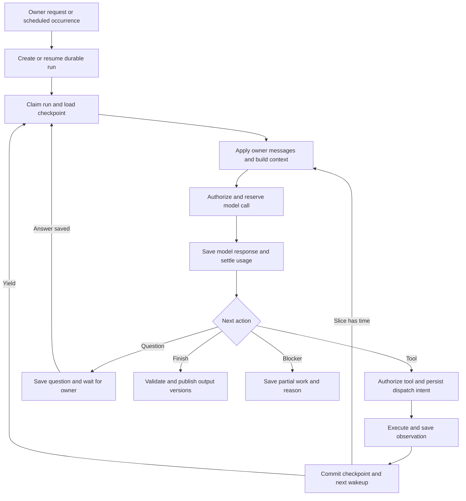

# Durable execution for general agents

Status: proposed, October 25, 2026. This document plans application work; it does
not implement or enable a new runtime. Current behavior remains documented in
[General agents](../general-agents.md).

[Agent data and trust](agent-data-trust.md) adds the confidentiality requirements:
protected content, separate instruction authority, scoped access, disclosure policy,
derived-data restrictions and deletion. These requirements constrain this plan's
storage, context, tool and recovery contracts; logical JSON examples are not a
proposal to persist confidential content as plaintext.

## Recommendation

Build a small, application-owned coordinator around the existing control plane,
database and Render workers. A run repeatedly decides, acts, saves the result and
continues. The goal, working plan, observations, outputs and limits survive worker
restarts and owner conversations. Begin with one action in flight per run.

The unit of execution is **one objective or scheduled occurrence, containing all
its outputs**. Multiple outputs share research and working state. A topic, source
list or report format belongs in the agent's instructions, not in runtime code.

Use the existing Responses integration behind a new single-decision interface.
Keep Habitat authoritative for execution state, authorization and accounting.
This lets us deliver a useful vertical slice without replacing the scheduler,
budget ledger, owner inbox or deployment stack.

## What changes from today

| Current implementation | Proposed behavior |
| --- | --- |
| `workflow/service.py` creates a job for each configured output | One general run owns the occurrence and all expected outputs |
| `openai_inference.py` expects a finished deliverable or clarification after one response | A decision may request another tool action, ask the owner, save work, finish or report a blocker |
| Search metadata is retained with an output | Source observations are saved and reusable throughout the run |
| `workflow_inference_attempt.version` mixes model calls, questions and output revisions, with a limit of 12 | Step sequence, dispatch attempts, plan revisions and artifact versions have separate identities |
| Owner answers lead to regeneration with the saved brief and answers | Answers resume the same run at its checkpoint, retaining completed research |
| Render caches an inference result but has no general continuation checkpoint | Workers claim bounded slices of a persistent run, then yield and enqueue continuation |
| Any inflight/unknown inference attempt blocks inference globally | Per-run ownership prevents conflicting execution; shared budgets remain atomically enforced |

Keep the existing demo and purchase workflows on their current paths. Route new
general runs through the new runtime behind an explicit configuration switch.
Historical attempts, holds and outputs retain their existing identities.

## Work model and planning

An **agent definition** stores a reusable objective, inputs, expected outputs,
criteria, tool grants, resource limits and optional schedule. A **run** snapshots
that definition for one occurrence. Owner steering is an ordered amendment to that
run; it does not silently rewrite future occurrences.

A **plan item** describes an outcome, such as inspecting sources or comparing
alternatives. An **execution step** records a concrete model decision or tool
operation. One item can require many steps. A **dispatch attempt** records one
actual provider request, including retries and its cost. An **artifact version**
records saved evidence, a draft or a final output.

The first model decision proposes a short plan and its next action together.
There is no mandatory extra planner call before every action. Plan items contain:

- Stable ID, title and success criteria.
- Dependency IDs and state: `pending`, `active`, `completed`, `blocked`,
  `failed` or `superseded`.
- Evidence/output references and a concise result or blocker.

Store the small plan as versioned protected checkpoint data initially; a task table and
parallel graph scheduler are unnecessary for serial execution. Validate IDs,
dependencies, cycles and patches against the expected plan version. Replan when
new evidence, owner direction or a blocker warrants it, preserving completed work
and the reason for changes. A plan cannot add permissions or increase limits.

Completion is evidence-based: required artifacts must exist, references must be
valid, and each criterion must have a recorded assessment. Separate deterministic
checks from model self-assessment. A model's claim of completion is not independent
fact verification. Owner acceptance remains separate from execution completion.

## The loop



The model adapter returns a typed decision:

```text
decide(context) -> {
  plan_patch?,
  progress_summary,
  action:
    call_tool(name, arguments, plan_item_id?)
    | ask_owner(question, options?)
    | finish(artifact_refs, inline_drafts?, criterion_assessments)
    | report_blocker(reason, partial_artifact_refs)
}
```

The first adapter uses structured JSON decisions with provider-hosted tools
disabled in `decide()`. Habitat dispatches the requested operation through its
tool registry. Hosted web research, when available, is a separately authorized
and reserved tool attempt; it is not silently performed inside a planning call.
This keeps the wire contract compatible with the current structured-output adapter.

Internal artifact tools save drafts and retrieve earlier findings. A decision may
also submit bounded inline drafts to save as versioned artifacts during the finish
transaction, avoiding an extra model round trip just to finalize a short output.
Strict schemas, bounded payloads and server-side validation apply to all actions.
The model proposes transitions; the coordinator decides which are valid.

One action per decision is a starting concurrency policy, **not one action per
output or owner message**. The coordinator automatically makes further decisions
until completion, a genuine wait, cancellation or a cumulative limit.

Provider-hosted search is a separate durability boundary: one Responses request
can contain provider-managed activity. Habitat can checkpoint that request's
result, not every internal search/open event. Describe it honestly as one bounded
research operation. Application-owned page reads and browser observations get
their own checkpoints. Do not represent a hosted trace as separately recoverable
tool execution.

Research results distinguish provider-synthesized findings and citation metadata
from captured source text. A citation URL does not mean the underlying page was
saved; subsequent page reads retain their own source excerpts and provenance.

## State and storage

Use the existing persistent database, owned by the control-plane service. Remote
workers use scoped APIs; they do not share or mount the SQLite file. All rows and
artifact lookups are tenant/instance scoped from authenticated context.

| Proposed record | Responsibility |
| --- | --- |
| `agent_run` | Goal/config version, occurrence or request identity, parent revision run, status/reason, current plan/checkpoint, owner-message cursor, cumulative limits, state version, lease owner/expiry/fence |
| `agent_step` | Ordered model decision or tool action, associated plan item, input/output references and execution state |
| `agent_attempt` | Actual dispatch identity and input digest, adapter/version, effect/retry class, authorization snapshot, hold ID, provider ID, receipt, usage and uncertainty |
| `agent_artifact` | Versioned observations, drafts, outputs and context summaries; retained content or durable blob reference, hash, provenance and timestamps |
| `agent_event` | Ordered owner messages and execution/progress events with deduplication keys; plan changes and applied-message cursor remain traceable |
| `agent_wakeup` | Transactional outbox plus worker-slice identity, availability time, delivery state, backend task identity and compute hold/receipt linkage |

Enforce unique run admission by instance and trigger identity: a scheduled due
time, owner request key or revision request key. Replayed admission returns the
same run; changed input under the same key conflicts. Enforce step sequence within
a run and deduplicate dispatches, receipts and owner messages by their own IDs.

The current-state rows are authoritative for execution. The event journal explains
changes; it is not a second orchestration engine. Reuse canonical budget holds,
usage and audit records rather than inventing another ledger. Existing security
audit payloads remain compact; source content and model history belong in the
artifact/event store. Large screenshots require durable blob storage; a worker's
temporary filesystem is not a checkpoint.

Sensitive fields in these logical records are encrypted content references,
including definition snapshots, plan text, owner messages, URLs and result bodies.
Access requires both tenant/run scope and an explicit resource/purpose grant.
Context assembly and outbound disclosure each pass the data-policy gate; a tool
grant alone cannot authorize sending confidential content to that tool.

Run lifecycle:

| State | Meaning and next transition |
| --- | --- |
| `queued` | Eligible now or at a saved wake time; worker can claim it |
| `running` | One current lease holder is advancing the run |
| `waiting_owner` | Durable question or approval request; matching answer queues the run |
| `waiting_external` | A known asynchronous operation is pending; reconcile its identity |
| `blocked` | Budget, permission, context, repeated lack of progress or unknown outcome needs resolution; reason determines the allowed resume action |
| `paused` | Owner explicitly paused execution; owner resumes it |
| `completed` | Required outputs and completion checks are recorded |
| `failed` | Terminal known failure, with explanation and preserved partial work |
| `cancelled` | Owner stopped this run; late receipts can still settle |

Yielding returns to `queued`, with the same run ID and checkpoint. A partial output
at a limit does not make the objective completed. Missing transport confirmation
does not make an operation failed. Budget counters and unresolved holds survive
every transition, restart and owner reply.

## Transactions, worker ownership and recovery

1. Claim an eligible run by compare-and-set. Increment its fencing token and
   establish a renewable lease using control-plane time.
2. Load the checkpoint and consume owner events up to a known cursor. Check pause,
   cancellation and current grants before preparing another action.
3. In one short database transaction, persist the exact step/attempt input,
   authorization, bounded reservation and dispatch intent. Bind the operation key
   to the input digest. A replay with different input is a conflict.
4. Recheck the run version and consumed owner-message cursor before admitting a
   model-proposed action. If new direction arrived, retain and settle the model
   response, apply the messages and reconsider the action first. Atomically mark
   an admitted attempt as dispatching under the valid lease and current controls.
   Supersede obsolete prepared attempts and release only holds proven undispatched;
   never mutate their input or reuse their identity for a changed action.
   Perform network I/O outside the transaction. A crash after this boundary can
   leave an unknown outcome, even if the request never arrived.
5. Save bounded, sanitized provider evidence and request identity durably before
   semantic validation. Never store credentials or authorization headers in the
   execution journal. Settle known usage idempotently even for unusable output;
   invalid content cannot advance the plan, and unknown usage retains its hold.
   Receipt recording must survive a later checkpoint-apply failure.
6. Apply the result, update the checkpoint and append the next wakeup in a
   transaction under the current fence. Applied-result IDs prevent duplicate
   plan/artifact changes. If a result is saved but unapplied, recovery applies it
   against the current run state and owner-message cursor.
7. Continue within the worker slice, or yield before its deadline. Only start an
   operation when enough slice time remains for its timeout and checkpoint margin.

Model decisions and external tool calls each follow this protocol and have
separate reservations when separately billed. Keep one deduplicated pending
continuation per run/checkpoint generation. While a healthy slice owns the run,
the continuation cannot launch another worker; the current slice can consume it
and advance. An outbox dispatcher may redeliver a wakeup. Unique identities and
fenced claims prevent duplicate state changes. A durable reconciler scans due wakeups,
expired leases and unapplied receipts; continuation does not depend on an open
browser tab, a process-local timer or the user sending another message.

Worker provisioning has its own cost and uncertainty boundary. Reserve compute
before submitting a stable slice identity to Render, save the returned task ID,
and reconcile `submission_unknown` before offering another slice. A lost submit
acknowledgement must not cause a second paid worker launch. Fencing alone cannot
prevent duplicate compute charges; reuse the existing submission-recovery rules.

A stale worker cannot advance the run. A narrowly scoped receipt endpoint may
still accept and settle a late result against its original attempt once; that
endpoint cannot authorize further actions. Owner pause, revocation or cancellation
stops future dispatch at the next boundary but does not erase costs already
incurred. Best-effort provider cancellation is not proof of no charge.

| Observed condition | Recovery rule |
| --- | --- |
| Prepared and provably never dispatched | Dispatch if still authorized |
| Successful result already saved | Reuse it; do not call the provider again |
| Known no-charge rejection or failed read with resolved billing | Bounded retry with backoff, recorded attempt and any new reservation; reads may still incur cost |
| Known asynchronous request | Poll/reconcile that request identity; account for polling cost if applicable |
| Provider supports verified idempotency | Reconcile/replay the same logical operation key within its documented contract |
| Unknown billable call or external effect | Retain the hold and block automatic resend until reconciled |

Lease expiry authorizes orchestration recovery, not replay of an uncertain
external action. Do not promise exactly-once execution at an external provider.
Exactly-once local settlement and application of recorded results are enforceable.

## Owner conversations and recurring work

Creating a question, checkpointing the run and entering `waiting_owner` happen
together. Reuse the owner inbox and its scoped, versioned answers. Saving an answer
and a deduplicated wakeup also happen together. The worker consumes the answer once
and resumes the same objective with its saved evidence.

Answers and wakeups do not clear an owner pause, cancellation or unrelated pending
questions. Resumption checks every outstanding blocker and current run state.

| Owner event | Behavior |
| --- | --- |
| Answer to an open question | Resume the same run |
| Direction while the agent works | Append a message and apply it before the next action; replan as needed |
| Revised direction invalidates an in-flight action | Retain and account for the outcome, mark it obsolete for future planning if appropriate |
| Permission or budget change | Apply through owner controls and recheck before dispatch; a chat answer alone cannot widen grants |
| Feedback after completion | Create a linked revision run referencing prior evidence and immutable output versions |
| New scheduled occurrence | Create a new run from the current definition; reuse prior evidence only with freshness checks |

Default overlap policy: one active occurrence per agent. Coalesce missed due times
into at most one pending occurrence, recording which times were coalesced. The
pending occurrence uses the latest due time and configuration when it is admitted;
its snapshot then becomes immutable. If the existing run is waiting or blocked,
show that fact rather than silently accumulating work. Schedule edits affect future
occurrences; explicit run steering affects the active run.

## Context, evidence and efficiency

Keep three layers: retained source records; current working state; and the bounded
context sent to the model. Context includes the objective and amendments, current
plan, output criteria, unresolved questions, recent completed exchanges, relevant
artifact excerpts and a versioned working summary. Retrieve evidence by references
and simple metadata/text lookup initially; a vector database is not required.

Store source URL, observation time, publication date when known, content hash and
the retained excerpt separately from the model's interpretation. Mark truncation
and stale observations explicitly. Search results are leads; source reading is a
separate action where supporting detail is needed. Screenshots are artifact
references with a bounded image budget, not repeated full images in every prompt.

Compact when context approaches its configured allowance. A summary records its
source-event range, evidence references, open questions and unresolved constraints.
It supplements retained records and does not itself delete the original objective,
receipts, pending calls or evidence. Explicit retention/deletion policy still applies
and can invalidate dependent runs. Compact only at a completed tool boundary;
keep tool-call IDs and any provider-required continuation items intact. Opaque
provider reasoning state, when needed for protocol continuity, is not a visible
work plan. [Responses function-calling contract](https://developers.openai.com/api/docs/guides/function-calling).

The initial structured-decision adapter has no open native function-call items.
An adapter that later uses native function calling must preserve its complete
call/result protocol across these same checkpoints.

Budget compaction calls like any other model work. Keep owner instructions
retrievable and never silently truncate them; use a clear context-limit blocker
when lossless required context cannot fit. Apply retention/storage quotas to
artifacts, with active-run references protected from routine garbage collection
but subject to explicit deletion and retention rules. Summaries and model-produced
actions inherit restrictions from their actual input context; compaction cannot
turn confidential evidence into public content.

The main efficiency measures are shared evidence across outputs, reuse of saved
results, small tool responses and selective retrieval. Keep a stable instruction
prefix where possible, but do not assume prompt-cache discounts when reserving
cost. Start with a single agent. Add bounded parallel independent reads only after
aggregate reservations, ordered result application and cancellation are proven.

Measure cost and model/tool calls per completed objective, context size, replayed
results, recovery latency and incomplete criteria. Use these observations to tune
limits and later parallelism; saving tokens at the expense of repeated failed work
is not an efficiency gain.

## Tools, browser access and limits

Each registered tool defines its schema/version, required capability and resource
scope, cost estimator, timeout, result-size bound, effect class, retry policy and
reconciliation operation. The registry reports actual implementation availability;
the model cannot invent a capability by naming it in a plan.

The first useful tool set is generic: search, public page read, public browser
view/inspection, artifact read and artifact write. Browser view means rendering a
page, inspecting visible content and capturing a screenshot. Start with navigation,
scrolling and observation; authenticated changes, form submission and purchases
need separately authorized tools and effect-specific recovery.

Reuse the browser broker's isolation and network enforcement through a general
read adapter. Do not turn the purchase-specific browser workflow into a universal
tool. Public browsing gets an explicit owner-reviewed grant and server-enforced
public-destination policy; it must not silently broaden an existing exact-domain
grant. Validate redirects and page subresources as well as the initial URL.
Retrieved pages, documents and tool output are untrusted evidence, not instructions.

Public browsing starts in a fresh unauthenticated browser context. It cannot
restore owner cookies or reuse an authenticated session based only on a public-
browse grant. Authenticated session restoration requires its own explicit grant.

Browser sessions hold credentials and storage outside model context. Checkpoint
URL, observation, time and session generation. A new browser may safely navigate
and inspect again; saved cookies do not restore tabs, form contents or JavaScript
memory. An expired session causes a new observation or owner request, never an
assumption that the previous page state still exists.

Enforce run-wide limits for spend, model decisions, tool actions, retries, active
execution time and retained evidence. Optional wall-clock deadlines are separate
from active time so waiting for an owner is not counted as worker execution. All
counters persist across slices; only explicit owner changes can raise limits.
Repeated identical failed actions or decisions with no new evidence/checkpoint
trigger a bounded replan, then a clear blocker. Do not loop indefinitely.

Every dispatch checks the run allowance, instance daily/monthly budgets, service
credit and platform ceiling against **spent + held + the new reservation** in one
transaction. Compute for every worker slice and model work used for planning or
compaction must be included. Release workers on waits and pauses; account for any
later reconciliation slice separately.

Platform totals must include both legacy workflow and new runtime usage and
held/unknown reservations. Move the current legacy attempt-table calculation to
a shared accounting query/service before removing its global inflight lock.
Preserve platform overrun quarantine across both paths; each path cannot receive
an independent copy of the platform ceiling.

**Cost-bounds work is required before enabling repeated live research.** The
current hosted-search 168,000-input allowance is an estimate, not an enforced
maximum. Multiplying it across a loop does not create a strict spending guarantee.
For each adapter, prove the maximum billable input/output/tool activity and pricing
tier, or use a provider/operation with an enforceable bound. A separately metered
search adapter returning capped results is an option if hosted search cannot meet
the contract. Unknown usage retains its reservation; an overrun is charged honestly
and stops further work. Do not relabel estimates as hard limits.

## Integration boundaries

Create `backend/aicl/agent_runtime/` with a transition service, persistence layer,
context builder, model adapter and tool registry. Keep these interfaces narrow:
`create_run`, `advance_slice`, `record_receipt`, `append_owner_message`,
`resume_run`, `cancel_run` and `reconcile`. Local and Render execution call the
same transition service.

Reuse existing services, with explicit coupling repairs:

- **Accounting:** extract/reuse reservation and settlement logic from
  `workflow/inference_service.py` and `control/budget.py`; keep existing holds and
  usage authoritative. General attempts must not be forced into the legacy
  per-deliverable version column or its 12-version cap.
- **Authorization:** use the existing gate's policies and confirmation semantics.
  New tools call the same control-plane checks; workers hold scoped run authority,
  never model, payment or account credentials.
- **Owner inbox:** `owner_request.workflow_run_id` is currently mandatory. Add a
  constrained general-run target and target resolver, preserving legacy requests
  and browser links. Enforce exactly one legacy-job/general-run target and target-
  scoped deduplication. Do not fabricate a demo job to ask a run-level question.
- **Scheduling/Render:** retain schedule admission, provider client, scoped worker
  authentication and compute charging. New wakeup/slice identities must permit
  many slices for one occurrence; the existing `(instance, scheduled_for, kind)`
  dispatch identity and inference-attempt mapping cannot simply be reused.
- **Outputs/UI:** expose versioned artifacts through existing output review where
  practical; any compatibility rows are projections, not competing execution state.
- **Chat:** the assistant creates or addresses an existing run and reads its
  progress. It does not start a second execution loop to answer a status question.

SQLite remains appropriate for the initial single control-plane deployment with
short transactions. Database failover, multi-host writers and distributed execution
are separate scale decisions. Durable here means surviving process/worker restarts
with the database and artifact storage retained, not surviving loss of all storage.

## Runtime/framework choice

Use direct Responses decisions first because they align with the existing paid-
dispatch boundary. Preserve one application-owned conversation history, including
the protocol items required for tool continuation. Avoid mixing full local replay
and provider-managed history without an explicit reconciliation strategy.

The Agents SDK already provides the model/tool loop, sessions and interruption
state; those are useful adapters, but they do not remove Habitat's transactional
authorization and side-effect journal. The existing chat SDK integration can remain.
[SDK loop and continuation options](https://developers.openai.com/api/docs/guides/agents/running-agents).

The managed Agents API offers hosted orchestration, recovery and compaction.
Its usage reporting is documented as best-effort, may change or be missing, and
does not expose separate cache-write counts. It is not a demonstrated drop-in fit
for our reservation and settlement contract. Reconsider it when pre-dispatch limits,
stop behavior and reconciled billing can be verified.
[Managed runtime](https://developers.openai.com/api/docs/guides/agents-api/overview),
[usage limitations](https://developers.openai.com/api/docs/guides/agents-api/observability).

Defer Temporal/LangGraph adoption for this first serial runtime. Adding another
checkpoint authority would introduce integration work while leaving our budget,
owner-control and uncertain-outcome requirements. Keep scheduler/model/storage
interfaces replaceable so a later scale requirement can justify that decision.

## Delivery plan

Build in small increments around one end-to-end scenario, using scripted model
and tool adapters before paid providers. These are proposed work packages, not
completed implementation tickets.

| Order | Work package | Exit evidence |
| --- | --- | --- |
| 1 | Define decision/result contracts, run transitions, scope/data-policy/protected-content interfaces, identity rules and cost-bound adapter contract; choose compatible live adapters | Scripted unrelated goals use the same contract; data-scope/disclosure denials are enforced; live adapter bounds are documented or marked unavailable |
| 2 | Add runtime records, transactional wakeups, fenced leases, receipt replay, per-step reservations, cumulative accounting and reconciliation scans | Kill/restart and duplicate delivery preserve progress; saved calls and usage are not repeated; unknown dispatch remains blocked |
| 3 | Add editable plans, shared artifacts, bounded context, owner inbox targeting and steering/resume | A multi-step fake run produces two outputs from shared findings, pauses for an answer and resumes the same run |
| 4 | Connect Responses decisions, search, public page reads and browser view | Multiple searches/reads/observations feed later decisions with durable provenance; existing controls gate each dispatch |
| 5 | Connect scheduled admission, Render slices and the existing reconciler to hosted execution; add progress UI | A run spans worker slices and owner waits without an open chat; UI survives reload and exposes plan, evidence, spend and blocker |
| 6 | Exercise failure cases and roll out general-run routing behind configuration | Focused integration/browser checks pass; legacy behavior remains intact; paid staging evidence is distinct from fixture evidence |

After the contracts, persistence/worker recovery and the read-only tool adapters
can be developed in parallel. Owner inbox/UI work can use saved fixture run states.
Integrate against the same scenario throughout instead of building separate demo
engines for each contributor.

The first proof milestone, after package 3, uses scripted adapters and local
worker slices: plan, several tool calls, restart, owner answer and two outputs
from the same saved findings. This proves the loop before live provider or browser
integration. Adapter cost-bound research in package 1 does not block fake execution.

The first live release milestone is a general run that **plans, searches, reads
several pages, saves findings, survives a worker restart, asks one owner question,
resumes and produces two outputs**. Repeat with an unrelated objective through exactly the
same engine. This establishes general capability without source-specific code.

## Acceptance and owner experience

Use a few focused scenarios that cover meaningful failure boundaries rather than
a test for every helper. Required evidence includes:

1. Shared research and distinct output versions across two unrelated objectives.
2. Crashes before dispatch, after dispatch but before receipt, and after receipt
   before checkpoint; lost acknowledgements and stale workers cannot duplicate
   local settlement or repeat a recorded action.
3. Owner answer and steering replay, permission revocation, pause/cancel and budget
   exhaustion; late paid results settle without restarting stopped work.
4. Context compaction/retrieval retains evidence, unresolved questions and output
   criteria; repeated unproductive actions stop with an explanation.
5. Browser observations survive worker replacement as saved evidence; session
   expiry requires re-observation; retrieved instructions cannot widen authority.
6. Duplicate scheduled admission, coalesced overlap and explicit output revision
   produce the intended distinct run identities.

The owner sees the current plan and activity, findings/source links, drafts and
outputs, actual and reserved spend, and a specific reason when work waits. Show
observable progress such as “4 sources inspected; comparing findings.” Do not
invent completion percentages for a plan that can change. Provide pause, resume,
cancel and steering in the run conversation; reserve approval UI for actions that
actually need new owner authority.

Keep first-release limits explicit: serial execution, bounded research and public
browser inspection. Parallel subtasks, arbitrary code, authenticated website
changes and outbound publishing can follow through the same tool contracts.
