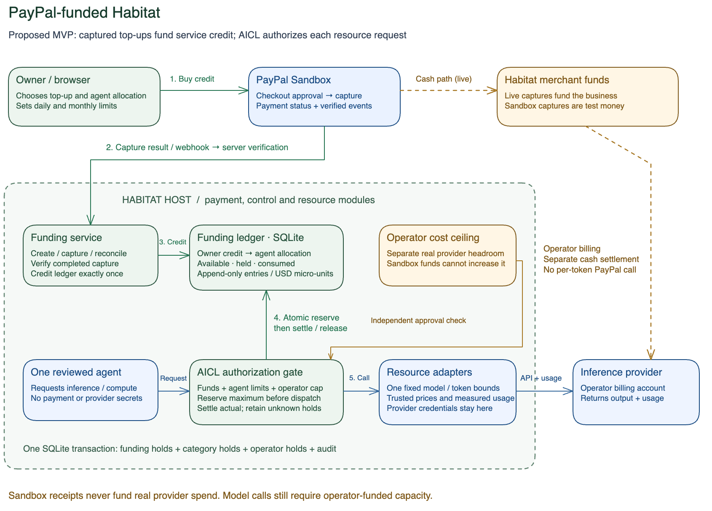

# PayPal funding for agent operations

Status: proposed implementation design, October 19, 2026. This is the PayPal
hackathon extension to the current owner-control MVP. Payment and real inference
adapters are not implemented yet. The completed E11 scope and its evidence remain
historical records, not proof of this extension.

## Product decision

The owner buys **prepaid Habitat service credit through PayPal** and assigns it to
an agent. AICL spends that allocation on authorized inference and, when metered,
compute or other Habitat-provided resources. A completed top-up funds many small
resource requests. There is no PayPal checkout for each model call.

Use **immediate capture of the owner-approved top-up**, not a temporary PayPal
authorization as the agent's balance. This supersedes the earlier demo proposal
to authorize a ceiling and capture a fixed charge for each job. PayPal's Orders
flow supports server-side capture after buyer approval. [Orders integration](https://developer.paypal.com/api/rest/integration/orders-api)

First release: one reviewed agent, one fixed inference model, USD, manual top-ups,
one application host, and one persistent SQLite database. The funding contracts
support multiple owner-controlled instances without accepting arbitrary programs.

## Where the money goes

**Commercial cash path:** owner → PayPal → Habitat's merchant account → the
operator's normal provider billing arrangement. Captured proceeds help fund the
business's resource costs; capture completion does not guarantee immediate
withdrawable cash or instant provider credit.

**Application spending path:** completed capture → Habitat service-credit ledger →
agent allocation → per-request reservation → measured resource charge.

PayPal handles collection. Habitat maintains the customer's entitlement to its
services and pays the inference provider from its own billing account. This design
does not assume a universal PayPal-to-model-provider transfer API. The operator
must maintain sufficient provider credit or billing capacity and a separate cost
ceiling before enabling real calls.

In the hackathon, PayPal Sandbox produces test receipts and test service credit.
Real inference still costs the operator real money. A sandbox top-up cannot raise
the operator's real spending ceiling. Display both environments explicitly.

[Editable diagram](diagrams/paypal-funded-aicl.excalidraw)

## Four amounts with different meanings

| Amount | What it means | Who changes it |
| --- | --- | --- |
| Prepaid service credit | Captured top-ups less consumed service charges, refunds, and reversals | Verified payment finalizer and metered settlement |
| Agent allocation | Unconsumed credit assigned to this agent; part may be reserved by active work | Owner transfers credit; AICL reserves and consumes it |
| Spending limits | Daily/monthly ceilings for inference and applicable other categories | Owner; increasing a limit creates no credit |
| Operator cost headroom | Maximum additional real provider cost the deployment permits | Operator only; independent of owner or sandbox funding |

An owner allocation transfers existing credit; it does not create more money.
Account totals include both unallocated credit and agent allocations. Do not
subtract allocations a second time from the displayed total.

For the MVP, a $5 top-up purchases $5 of service credit. Record gross capture,
processor fees, net receipt, and issued credit separately. The operator absorbs
payment fees in this proposed demo pricing. Customer service rates and provider
cost rates are versioned separately, even if initially equal. Equal rates do not
cover payment fees or fixed hosting overhead and do not prove profitability.

## Owner journey

1. Create an agent and set its instructions, allowed capabilities, and daily/monthly
   limits. Its initial funded allocation is zero.
2. Choose **Add funds with PayPal**, select a server-approved USD amount, and see
   the intended agent allocation. Funding from an agent's page can assign the
   completed top-up to that agent when the owner explicitly selects this option.
3. Approve checkout in PayPal. Returning to Habitat initially shows **Verifying
   payment**; a browser redirect is not payment evidence.
4. Habitat verifies the completed capture and posts the credit exactly once. If
   the selected agent was archived or is no longer eligible, the credit stays in
   the owner's unallocated balance instead of being lost or assigned elsewhere.
5. Review **Available**, **Reserved**, **Used**, and the spending limits, then run
   the agent. Each billable call must fit both funded credit and policy limits.
6. View the useful output, actual resource usage, and funding receipt. A low
   balance gates new work with **Add funds**; a limit breach links to **Adjust
   limits**. These are different recovery actions.

Funding rechecks a funding-related gate. It never resumes an owner-paused or
archived agent, enables a capability, or increases daily/monthly limits.

## What the agent may do

The owner delegates inference within the funded allocation and configured policy.
Individual model calls do not require a second owner approval. The agent may read
its available allowance, request a bounded inference operation, and report that
more funding is needed. It cannot top up automatically, change limits, transfer
allocations, request refunds, or access payment/provider secrets.

The separate [purchase tool](../agent-purchases/spec.md) is also a core MVP
capability. It lets the agent propose and complete a seller purchase after exact
owner approval and PayPal buyer consent, through the AICL purchase broker. The
agent has no unrestricted capture authority. Habitat service credit is not a
general-purpose payment account; merchant purchases use the buyer's PayPal checkout
and a separate purchase-policy ceiling. Purchase receipts never mint service credit.

## Request authorization and accounting

Before each call, the server builds a trusted maximum charge from the assembled
input, approved model, enforced output-token ceiling, timeout, and price version.
Agent/client estimates never authorize real spending.

One database transaction checks ownership, lifecycle, capability, available agent
credit, applicable daily/monthly limits, and the operator's real-cost headroom. It
reserves the maximum customer charge and provider cost, creates the work record,
and appends the audit event. Only after commit may the adapter contact the provider.

The adapter enforces the quoted bounds. On a known result, settlement records the
actual customer charge and provider cost, releases the unused reservation, saves
the output reference, and updates the UI. A timeout or missing usage retains the
reservation until reconciliation; an unknown result is neither free nor safe to
retry with a new request ID.

Example with illustrative prices: a captured $5 top-up is allocated to one agent.
A call reserves at most $0.05, so $4.95 is available and $0.05 reserved. If its
measured charge is $0.02, settlement leaves $4.98 available, no reservation, and
$0.02 used. This uses one top-up capture, not two PayPal transactions. Actual demo
amounts must come from the configured provider and price table.

## Inference, compute, and later resources

Start with one nonstreaming, bounded model call per reviewed task. A small bounded
loop can follow; each iteration reserves separately and also respects a run cap.
Persist provider/model identity, request identity, token usage, and the output.

Do not turn the current user-entered “compute minutes” simulator into a real bill.
Compute can draw from the same funded allocation once the adapter enforces a
time-bounded lease, measures usage, and stops or renews only after another funded
reservation. Until that meter exists, shared hosting is operator-provided capacity
and is labeled as such. A zero compute charge does not require a positive compute
budget just to allow inference.

## Payment behavior visible to the owner

| Observation | UI and credit behavior |
| --- | --- |
| Checkout ready / buyer approved | Await capture; no funded credit yet |
| Capture pending | Payment pending; no credit and no promise that a retry is free |
| Verified completed capture | Credit once, show receipt and allocation |
| Definitive failure or cancellation | No credit; explain the next safe action |
| Timeout or ambiguous result | Verifying payment; reconcile the same attempt |
| Refund, reversal, or dispute evidence | Restrict new spending, reconcile, and append adjustments; preserve history and outstanding holds |

Completed capture, not HTTP success or order approval alone, is the funding event.
[Capture reference](https://developer.paypal.com/api/orders/v2/orders-capture)

## UI changes

Add an owner **Funds** page and a compact funded-balance section on the agent page.
Checkout previews amount, currency, environment, and destination allocation. The
receipt shows funding status, captured amount, issued credit, date, and a safe
transaction reference. Agent activity links funding, reservations, measured usage,
and output without exposing raw payment payloads or credentials.

Show clear readiness beside Run: active, required capability enabled, funded
allocation, applicable category headroom, and provider availability. Use distinct
messages for **No funds**, **Limit reached**, **Payment pending**, **Provider budget
unavailable**, and **Result under review**. Refresh balances and activity after a
state change; preserve useful result messages during refresh.

## Delivery order and acceptance

1. Build the funding ledger and atomic owner-to-agent allocations. Prove that two
   concurrent runs cannot reserve the same last credit.
2. Add PayPal Sandbox create/approve/capture and one idempotent finalizer shared by
   HTTP responses, verified events, and reconciliation. Show an actual receipt.
3. Extend AICL's existing reservation transaction with funded-credit and operator
   holds. Positive policy limits with no funding must still deny.
4. Add one bounded real inference adapter and a useful artifact. Missing usage
   retains holds; replay cannot charge or invoke the model twice.
5. Complete the Funds/readiness UI and rehearse: no funds → top up → run → usage
   debit/output → insufficient funds. Separately prove pending payment, duplicate
   delivery, timeout/restart, and a reversal racing a new reservation.

6. Add the [owner-approved purchase flow](../agent-purchases/spec.md), a distinct
   integrated Sandbox seller, and a paid digital asset used in the agent's output.
   Show its separate receipt and an unapproved-purchase refusal.

Funding plus real inference is the first vertical slice; both PayPal roles are
required for the revised complete demo. Extra sponsors, multiple models, cloud
deployment, and arbitrary agent programs are not prerequisites.
[Technical contracts](technical.md) define funding implementation and recovery.
