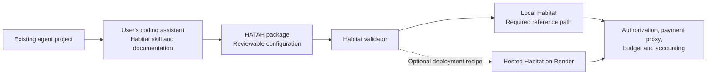

# Habitat hackathon MVP

Date: October 4, 2026  
Status: Current MVP scope and delivery proposal. This document describes intended behavior, not completed implementation.

Habitat lets an owner bring an existing AI agent, run it in a controlled environment, fund its resource use, and inspect its spending. The owner keeps the agent's framework, planning loop, tools, and application logic. Habitat supplies the runtime integration, authorization, payment proxy, budgeting, and accounting.

Onboarding is delivered through a documented package contract, a preparation skill, examples, and a validator. The user's existing coding assistant follows those instructions. We do not build a separate AI onboarding or migration product.

This is the current hackathon scope. It refines the [earlier project plan](habitat-project-plan.md), especially onboarding and deployment choices. The [economic loop outline](habitat-plan-outline.md) remains the longer-term vision.

## Value proposition

**Bring your agent. Package it for Habitat. Run useful work within an authorized budget.**

The initial audience hypothesis is developers and small teams with an agent that already works locally. They need a repeatable way to run it with controlled credentials, resource access, and spending without rewriting its behavior. Willingness to pay remains to be validated.

The prototype proves integration and control: two different agents use the same Habitat contract, complete useful work, and encounter enforceable spending limits. It does not prove profitability, independent agent finances, or support for every agent framework.

## Product vocabulary

| Term | Meaning in this MVP |
|---|---|
| HATAH | The packaged agent unit: existing project, dependency and startup instructions, workspace definition, and Habitat configuration. It is a packaging contract, not necessarily a VM image. |
| Habitat | The application that runs or manages a HATAH and governs its access to supported paid resources. |
| Preparation skill | Instructions the user's coding assistant follows to inspect and adapt a project to the package contract. |
| Validator | A deterministic command that checks the package and performs bounded integration checks. |
| Resource gateway | The enforced route for Habitat-funded model requests and any supported paid tools. |

The assistant preparing a package and the agent being packaged can be different programs. The runtime agent does not need to edit itself or understand the preparation skill.

## User journey

1. The owner opens an existing agent project in their preferred coding assistant.
2. Habitat's setup page provides the preparation skill, integration documentation, and example packages.
3. The assistant inspects startup, dependencies, model calls, storage, and credential requirements. It generates reviewable packaging and configuration changes and identifies unsupported requirements.
4. The owner runs Habitat's validator. It reports package errors, missing configuration, and the results of a representative execution check.
5. The owner sets the agent's permitted services, runtime limits, and spending allocation, then funds the allowance through PayPal Sandbox.
6. Habitat launches the agent. Authorized model calls pass through the gateway and are attributed to the agent and run.
7. The dashboard shows status, outputs, costs, reservations, and blocked requests. The owner can stop access or explicitly change authority.
8. If the optional hosted target is included, the same package contract feeds a Render deployment recipe, followed by validation on that target.

The final box represents shared responsibilities, not a requirement for local and hosted deployments to contact one central server or share one database.

## Required delivery

| Deliverable | Minimum content |
|---|---|
| Integration specification | Supported runtime, dependency installation, startup command, persistent workspace, runtime identity, model gateway configuration, and declared capabilities. |
| One preparation skill | A repeatable inspect, configure, validate workflow with examples and clear unsupported cases. |
| Package validator | Structural checks, startup check, workspace persistence check, gateway connectivity, and a bounded representative task. |
| Local Habitat runtime | One supported isolation backend, startup and stop controls, persistent files, and host-enforced resource and network restrictions. |
| Inference gateway | One provider and one supported API format, with authorization and budget reservation before billable requests. |
| Payment and accounting | PayPal Sandbox funding, verified payment records, allocations, reservations, usage charges, releases, and adjustments. |
| Small MCP interface | Budget and usage visibility, permitted capabilities, and a request for owner funding. |
| Owner dashboard | Setup instructions, policy and funding controls, run status, costs, blocked requests, and outputs. |
| Two example integrations | Different agent projects using the same contract without changes to Habitat's core. |
| Submission package | Complete public source, license, setup instructions, working demonstration, and video. |

Limit the release to one owner, one active agent environment at a time, one inference provider, and one currency. The two examples can run sequentially. A proposed first compatibility target is headless Python agents using one configurable model API; confirm this before implementation.

## Skills and documentation

The app exposes preparation guidance as copyable instructions or downloadable files. Users invoke the skill through their existing assistant. The assistant produces configuration and small adapters where required; it must make changes to agent behavior explicit.

The skill should explain how to:

- Find the entry point, dependencies, writable paths, and required external services.
- Configure a scoped Habitat credential and the supported inference endpoint.
- Describe persistent state, permitted tools, and runtime requirements.
- Keep long-lived provider, payment, and deployment credentials out of the package.
- Generate the startup and packaging configuration using the documented example.
- Run the validator and explain any remaining incompatibility.

**Skills help configure the agent; Habitat enforces the rules.** Instructions to use a proxy cannot replace runtime enforcement. The validator reports evidence from its checks; a passing sample task is not proof of universal compatibility or complete security.

Exact manifest fields and command names are implementation decisions. Deliver one simple documented format before adding framework-specific variants.

## Runtime and trust boundary

Run the owner-supplied agent in a supported VM or sandbox. Keep the controller, authoritative ledger, provider credentials, and PayPal credentials outside the guest. The owner chooses policy; the guest receives only delegated access.

Host-side controls limit CPU, memory, disk, execution duration, and outbound routes. Habitat-funded provider access must pass through the gateway. The agent cannot increase its own spending authority, edit accounting records, obtain the operator's provider keys, or reach host management interfaces.

MCP is optional for an agent. An agent that only supports ordinary model API calls can use the gateway without adopting Habitat's tools. MCP-aware agents can additionally inspect their remaining allocation and request intervention. Both interfaces use the same authorization and accounting rules. [MCP architecture](https://modelcontextprotocol.io/docs/learn/architecture)

Firecracker remains a candidate, not a confirmed implementation choice. It requires a suitable Linux/KVM host. If selected, document that host requirement clearly rather than promising native execution on every developer laptop. Prove one backend early and avoid building multiple isolation systems. [Firecracker documentation](https://firecracker-microvm.github.io/)

Preserve workspace files across restart. Resuming unfinished work depends on the agent's checkpoint and recovery behavior; generic memory migration and transparent recovery are outside scope. A paused process can still occupy billable resources.

## Payment proxy and accounting

The owner funds an agent allowance through PayPal Sandbox. Habitat mediates use of the operator's configured inference account. This is an internal allocation and service-access model, not an independently owned agent bank account or a general payout system.

For a supported billable request, Habitat authenticates the runtime, checks permission, atomically reserves a bounded maximum cost, dispatches the request, records measured usage, and releases the unused reservation. Limits include runtime consumption as well as model usage.

The ledger distinguishes confirmed funding, available allocation, outstanding commitments, actual charges, and adjustments. Payment events are verified and deduplicated. A timeout with an unknown provider outcome retains its reservation until reconciliation. Revoking access blocks new calls but does not undo charges already incurred.

Keep sandbox accounting separate from real operating costs. Simulated PayPal receipts must not automatically raise the team's real provider spending ceiling. Display hosting and storage estimates as estimates, and distinguish them from measured charges. Owner funding and an increase in a policy cap are separate actions when both constraints apply.

The preparation assistant's own usage is outside Habitat accounting unless it is explicitly integrated; the demo must not imply that wrapping an agent captures every expense involved in development.

## Local and hosted deployment

**Local Habitat is the required reference path.** One installation contains the controller, gateway, dashboard service, persistent records, and the supported agent environment. PayPal and inference remain external services. This is not an offline product.

**Render hosting is an optional deployment extension.** A supported project can use the same package contract with target-specific configuration. A Render Blueprint can describe the services and configuration; a continuously running agent may fit a background worker, while an agent exposing an HTTP interface needs an appropriate service type. These mappings require validation against the chosen examples. [Blueprints](https://render.com/docs/infrastructure-as-code), [Background workers](https://render.com/docs/background-workers)

A local VM and a Render service do not automatically provide equivalent isolation, network enforcement, storage, or lifecycle behavior. Document and verify the supported guarantees for each target. Hosting also moves project code and selected runtime data to the hosting operator; local wrapping and cloud upload are distinct steps.

Each independent deployment has one authoritative ledger. The MVP does not synchronize balances across local and cloud installations, migrate live processes, or provide seamless failover. It also does not require a separate local Habitat plus a central hosted service to operate the local reference path.

## Where Render Workflows fits

Workflows can provide optional task execution for an agent. They are not the mandatory agent runtime, and packaging must not require rewriting an agent's planning loop into workflow functions.

If included, use one useful, explicitly integrated capability:

**Local or hosted agent → Habitat gateway → authorization and budget reservation → Render Workflow → result and accounting.**

No direct MCP route should bypass the gateway. Keep Render deployment credentials outside the agent. Configure retries and task limits so cloud execution cannot create unbounded resource commitments or duplicate paid operations. Workflows execute registered tasks and do not currently provide native timed scheduling. [Workflows documentation](https://render.com/docs/workflows)

The Render sponsor page encourages deployment on Render and use of Workflows. A Render-specific recipe and a real workflow capability can strengthen that submission if the core is already complete. They are optional extensions, not reasons to compromise BYOA or expand into automatic workflow extraction. [Sponsor guidance](https://paypalaihackathon.devpost.com/details/render)

## Demo and acceptance criteria

The primary demo starts with an existing supported agent project. The user's coding assistant follows the preparation skill, produces reviewable changes, and passes the validator. The owner funds an allowance, runs useful work, inspects the accounting, and sees an over-budget request rejected. A second agent proves that the integration is reusable.

The core is complete when:

- Both example agents use the published contract without modifications to Habitat's core.
- Packaging preserves the demonstrated agent behavior; any required adapters are visible.
- The documented setup reproduces a successful bounded run on the supported local host.
- Model calls and supported paid tools pass through enforced authorization and budget checks.
- Concurrent requests cannot spend the same allocation twice, and duplicate payment events cannot create duplicate funding.
- Owner revocation stops new resource access and the controlled execution environment.
- Persistent workspace files and accounting records survive the relevant restarts.
- The dashboard links useful outputs and costs to the correct agent and run.
- Real costs remain capped independently of sandbox funding.

If Render is included, demonstrate the packaged agent actually running there. If Workflows is included, demonstrate a real authorized task and its result. Generated deployment files alone do not establish successful hosting.

## Build sequence

1. **Contract and feasibility:** select the first runtime, model API, provider, and two examples; prove an example can start and persist files under the required controls.
2. **Gateway and economics:** implement authorization, bounded resource access, payment verification, and the ledger.
3. **BYOA experience:** publish the preparation skill and examples, build the validator, and integrate the second agent.
4. **Owner interface and demo:** expose setup guidance, funding, controls, activity, outputs, and cost records; verify the complete flow.
5. **Optional Render extension:** add and validate one deployment recipe and, if justified, one workflow-backed capability.
6. **Submission:** publish the complete small implementation and reproducible instructions, and record the working demo.

The hackathon requires central PayPal integration, AI, a functional build, public open-source code, and a demo video under three minutes. The AI contribution includes preparation by the user's assistant and useful agent execution; PayPal enables the demonstrated funded resource-access flow. [Official rules](https://paypalaihackathon.devpost.com/rules)

## Explicitly deferred

A standalone onboarding agent, universal project migration, automatic workflow extraction, a provider marketplace, arbitrary uploaded cloud workloads, multiple owners or production multitenancy, distributed account synchronization, scheduled agent operation, autonomous customer acquisition, revenue-funded self-sufficiency, agent spawning, confidential hosting, and portable memory snapshots are outside the required MVP.

The next implementation decisions are the reference host and isolation backend, the exact package contract, the supported model API, and the two examples. Decide whether to include Render after the core path is proven.

## Related designs

- [Local and remote design sketch](diagrams/diagram-local-remote.png)
- [Earlier C4 Excalidraw diagram](diagrams/habitat-c4.excalidraw)
- [Earlier implementation plan](habitat-project-plan.md)
- [Prize inventory](hackathon-prizes.md)

The earlier C4 diagram describes the single-host runtime structure. It does not yet show the preparation skill, validator, or optional Render deployment path.
