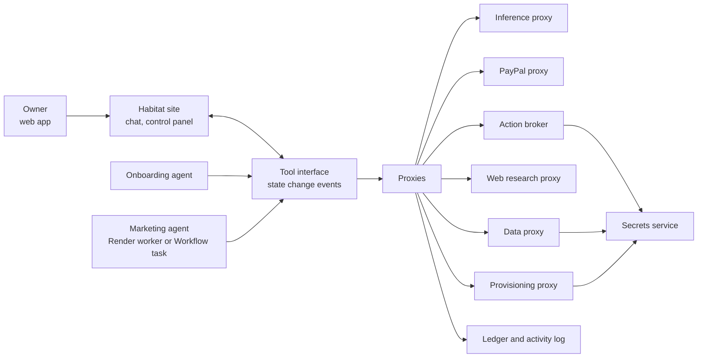

# Habitat hackathon MVP

Date: October 5, 2026  
Status: Historical October 5 marketing/PayPal proposal, retained for traceability. The current implemented MVP scope is [E11: AICL](plan/E11/_epic.md); see the [application guide](aicl-mvp.md) and [completion evidence](plan/E11/completion.md). The behavior below is the earlier proposal, not a claim about the E11 implementation. It replaced the October 4 bring-your-own-agent scope, which remains in git history.

Habitat lets a small business owner set up a trustworthy AI agent that does real work for them, within a budget they control. The owner describes what they want in plain language. Habitat's onboarding agent configures the account and the working agent while the page updates in front of them. The owner never sees infrastructure; they see what the agent is doing, what it costs, and what it is waiting for them to approve.

Trust is the product. Every model call, data read, external action, and dollar passes through Habitat-controlled proxies that authorize, meter, and log it. The agent itself holds no credentials, no payment rails, and no direct network access.

## Value proposition

**Tell Habitat what you need done. Set a budget. Watch a trustworthy agent do it, and stop it any time.**

The target user is a small business owner without an engineering team. They want results, such as more installs for their app, but cannot evaluate agent frameworks, cloud hosting, or API keys, and will not hand an unknown program their ad account and credit card without guarantees.

The MVP use case is **"Help me market my mobile app."** We demonstrate it by marketing the team's own existing app with real ad spend.

The prototype proves control and trust: a non-technical owner configures an agent through conversation, the agent performs real marketing actions including paid ones, and every cost and action stays within explicit authorization and hard limits. It does not prove marketing ROI, broad platform coverage, or production-grade security certification.

## Product vocabulary

| Term | Meaning in this MVP |
|---|---|
| Habitat | The hosted web application and the control plane behind it. |
| Owner | The business owner who funds, configures, and supervises an agent. |
| Onboarding agent | The conversational agent on the Habitat site that sets up the account and the working agent through the tool interface. |
| Marketing agent | The working agent that plans and proposes marketing work for one owner. |
| Proxy | A Habitat service that performs a category of access on the agent's behalf: inference, payments, secrets, actions, web research, data, provisioning. |
| Action broker | The proxy that executes typed external actions after policy checks, approvals, and cost reservation. |
| Connection | An owner-authorized link to an external account (for example Reddit Ads), held by Habitat as an encrypted secret. |
| Budget | The owner's USD allowance, split across inference, compute, and spending. |
| Approval | An owner decision required before an action proceeds. |
| Activity log | The owner-visible, append-only record of actions, data reads, secret uses, costs, and approvals. |
| HATAH | Internal name for one owner's agent deployment: configuration, connections, policy, and provisioned resources. Not shown to owners. |

## Owner journey

1. The owner visits the Habitat site and starts a conversation with the onboarding agent.
2. The onboarding agent asks about the business and goal ("Help me market my mobile app"), then creates the account, the marketing agent, and its plan through the tool interface. The page renders each change as it happens: profile, goals, channels, policy, budget.
3. The owner connects accounts (app store listing, Reddit Ads). Each connection shows in plain language what Habitat can and cannot do with it. Logins and two-factor steps are completed by the owner directly.
4. The onboarding agent proposes a USD budget split across inference, compute, and spending, plus approval rules. The owner adjusts it and authorizes funding through PayPal. It also guides the owner to set an account-level spend limit on each ad platform as an independent backstop.
5. Habitat provisions the agent's resources on Render. The owner sees "Your agent is running," not service types.
6. The marketing agent researches, drafts, and proposes actions. Low-risk actions within policy proceed; others wait in the approval queue.
7. The control panel shows costs by category, the activity log with evidence, pending approvals, live campaigns, and results.
8. The owner can pause, change limits, revoke a connection, or press the hard stop at any time.

## Trust model

Trust is the central requirement. The owner must be able to trust both the agent and Habitat itself.

| Commitment | Mechanism |
|---|---|
| The agent cannot act outside its authority | No direct network egress or credentials; every capability goes through a proxy that checks policy. |
| Nothing costs money without authorization | Every billable request reserves USD from the budget first; amounts over the approval threshold require an explicit owner decision. |
| Hard stops work | Habitat policy, platform-side caps on every campaign, an owner-set ad account limit, and a kill switch that pauses live campaigns as well as the agent. |
| Secrets stay secret | Per-tenant envelope encryption; secrets decrypted only inside proxies at call time; never placed in prompts, agent memory, or logs. The agent references connections by handle. |
| Least privilege | Minimal OAuth scopes, read and write access separated, plain-language scope descriptions on every connection. |
| Data use is visible | Every private data read records its purpose and appears in the activity log next to costs and actions. |
| Data flows are disclosed | Owners are told that data sent for inference reaches the model provider. Prefer a provider and settings with no data retention; send summaries rather than raw private data where possible. |
| The record is reliable | Append-only, hash-chained activity log that owners can view and export. |
| Revocation is real | Disconnecting revokes the token at the provider and deletes the stored secret. Revoking does not undo charges already incurred, and the UI says so. |
| Claims are verifiable | The complete source is public, as the hackathon requires. Trust claims can be checked against the code. |

**The honest limit.** In the MVP the Habitat operator holds the encryption keys and could technically access tenant secrets. We state this plainly instead of implying zero trust in the operator. Customer-managed keys and confidential computing are roadmap items.

## Architecture

Habitat's own services (site, tool interface, proxies, secrets service, ledger) are separate deployables. Only proxies can call the secrets service. Agent runtimes can reach only the tool interface and proxies.

### Proxy layer

| Proxy | The agent asks for | Habitat holds and enforces |
|---|---|---|
| Inference | A model call | Provider keys, maximum output tokens, USD metering, data-handling rules |
| PayPal | Funding status, a request for more funding | PayPal credentials, owner authorization, ledger entries |
| Secrets | Nothing directly; used by other proxies | Encrypted connection tokens, injected at request time |
| Action broker | A typed action, such as `create_reddit_campaign` | Policy, reservation, approval, execution, platform-side caps, evidence |
| Web research | Read-only browsing and search | A browser with no credentials, rate limits, no purchasing |
| Data | Reads of the owner's app and marketing data | Scoped read connectors, purpose tags, access log |
| Provisioning | "Deploy the landing page," "start the agent" | Render API key, resource caps, cost estimates |

### Action broker

The agent proposes; the broker executes. Actions are typed so they can be validated, priced, approved, and logged. For each action the broker:

1. Validates the action type and parameters against the agent's policy.
2. Estimates and reserves the maximum USD cost.
3. Requests owner approval when policy requires it.
4. Executes through a connector, injecting credentials from the secrets service.
5. Records the result and evidence, then reconciles actual cost.

Connectors, in order of preference:

1. **Official API with OAuth.** Deterministic, auditable, and easiest to cap.
2. **Browser recipe.** A parameterized, Habitat-authored Playwright flow running in a cloud browser with the owner's stored session, used only where no suitable API exists. Screenshots or recordings become evidence in the activity log. The agent never drives a logged-in browser free-form.
3. **Human handoff.** For login, two-factor, payment method setup, or anything a platform requires a person to do. The broker pauses, gives the owner a live browser or link, and resumes afterward.

Free-form browsing is allowed only through the web research proxy, which has no credentials and cannot buy anything.

### Agent runtime

The marketing agent is a long-running loop: plan, propose actions, wait for approvals or results, report. It runs on Render as a per-owner background worker or as Workflow tasks triggered by Habitat. Workflows do not provide native timed scheduling, so Habitat's controller owns timing. The agent stays simple because risk lives in the broker and proxies. [Background workers](https://render.com/docs/background-workers), [Workflows](https://render.com/docs/workflows)

## Tool interface

The tool interface is the single way to read and change Habitat state. The onboarding agent, the marketing agent, and the web UI use the same tools, subject to different permissions. Every successful mutation emits a state change event; the UI subscribes and renders it live, which produces the page that updates while the onboarding agent works.

Initial tool groups:

| Group | Examples | Used by |
|---|---|---|
| Account | create profile, set business details | Onboarding agent, UI |
| Agent | create agent, set goals, set channels, set cadence, pause, resume | Onboarding agent, UI |
| Policy | set allowed actions, approval thresholds, category limits | Onboarding agent proposes; owner confirms |
| Budget | propose split, request funding, read balance | Onboarding and marketing agents, UI |
| Connections | start connection, list scopes, revoke | Onboarding agent starts; owner completes |
| Actions | propose action, read action status | Marketing agent |
| Approvals | list pending, approve, reject | Owner only |
| Activity | read log, read costs, export | All, scoped to the owner |
| Provisioning | deploy resource, read status, stop | Onboarding agent, Habitat controller |

Rules:

- Agents can propose policy and budget changes; only the owner can confirm increases in authority or funding.
- No agent can approve its own actions, change its schedule, or create another agent.
- The tenant for every call is derived from authentication, never from tool arguments.
- Provisioning tools stay open-ended for now. Habitat's instructions and skills direct the agents toward the Render resources each project needs; the provisioning proxy enforces resource types, caps, and costs. Exposing the tool interface as an MCP server is optional. [MCP architecture](https://modelcontextprotocol.io/docs/learn/architecture)

Exact tool names and schemas are the subject of a follow-up specification.

## Budget and cost model

Owners see and set budgets in **USD only**. Internally, each category is tracked in its native unit and converted using a published price table, so every cost shown to the owner can be traced to a measured quantity and a rate.

| Category | Internal unit | USD conversion | Reservation before use |
|---|---|---|---|
| Inference | Input and output tokens per model | Provider price per token plus any Habitat margin | Maximum cost from input size and enforced output token cap |
| Compute | Render instance time and Workflow compute time | Render pricing per instance type and duration | Time-bounded lease, renewed against the budget; stop the resource if renewal fails |
| Spending | USD charged by the external platform | Already USD | Exact authorized amount; campaign lifetime budget set to the reserved amount |

The ledger distinguishes confirmed funding, available allocation by category, outstanding reservations, actual charges, and adjustments. Measured charges and estimates are labeled differently. A timeout with an unknown outcome keeps its reservation until reconciliation. Payment events are verified and deduplicated.

### Hard stops for real ad spend

Ad platforms bill ad spend to the payment method on the owner's ad account, outside Habitat's payment path. Habitat therefore cannot be the only control and layers its stops:

1. **Habitat policy:** the broker refuses actions beyond the remaining spending allocation and requires approval above the threshold.
2. **Platform-side caps:** every campaign is created with a lifetime budget equal to its reservation.
3. **Account limit:** the owner sets an account-level spend limit on the ad platform, guided by onboarding, independent of Habitat.
4. **Reconciliation:** the broker pulls platform spend reports and posts actual charges, releasing or adjusting reservations.
5. **Kill switch:** pauses the agent, pauses every live campaign through the platform API, and freezes new reservations.

### PayPal: authorized and metered payments

PayPal is how the owner authorizes the budget and how Habitat-provided services are paid for. The owner approves a USD amount through PayPal; Habitat meters inference and compute against it and captures what is actually used. External ad spend counts against the same budget but is settled between the owner and the platform.

A candidate implementation is a PayPal order with authorize intent, followed by captures for metered usage. Authorization validity and partial or multiple capture behavior must be confirmed for the account type before committing. [PayPal Orders API](https://developer.paypal.com/docs/api/orders/v2/)

Sandbox funding must never raise the team's real provider, hosting, or ad spending ceilings. Real costs are capped by operator-level limits independent of any owner funding.

## Deployment on Render

Everything runs server-side; there is no local product.

- **Habitat platform:** the site, tool interface, proxies, secrets service, and ledger run as Habitat-owned Render services with a managed database. A Blueprint describes them. [Blueprints](https://render.com/docs/infrastructure-as-code)
- **Per-owner resources:** the marketing agent runtime and any project resources it needs, such as a landing page site, created through the Render API by the provisioning proxy. [Render API](https://render.com/docs/api)

Which resources each owner gets, and the isolation between owners, stays open until the tool interface and the first use case are proven. Two constraints are fixed: owner resources never receive Habitat's Render, PayPal, or provider credentials, and a global cap limits the total resources and cost across all tenants.

## Data scope

In scope: the owner's app and marketing data, such as the store listing, reviews, basic analytics, and ad performance.

Out of scope: personal data of the owner's customers, such as email lists or user records. That brings privacy-law obligations beyond the hackathon.

## Security requirements

These requirements turn the trust model into rules the implementation must follow. Several come from failures observed in an earlier agent product of ours, where sound designs were undermined by checks that failed open or ran after the money was spent.

**Fail closed everywhere.** An error, timeout, missing configuration, unknown price, unknown action type, missing handler, or invalid session denies the request. Nothing defaults to "allow," "all tools," "unlimited," or "$0."

### Secrets and encryption

- Envelope encryption: a KMS master key wraps a data key per connection, and AES-256-GCM encrypts each secret. KMS calls carry an encryption context with tenant and purpose; the AES associated data binds tenant, connection, and field, so ciphertext cannot be moved between tenants or rows.
- Creating a data key and fetching one are separate operations. A missing key is an error, never a silent new key.
- Decrypted data keys may be cached only inside the secrets service, briefly, with a size cap and invalidation on revoke across instances.
- No plaintext shadow copies of encrypted fields. Fields needed for lookup use a keyed hash (HMAC blind index).
- Production uses KMS only; there is no local-key fallback mode. Key re-wrapping is a versioned job, never part of a schema migration.
- Secrets never appear in prompts, agent memory, logs, traces, message buses, or session state.

### Connections and OAuth

- Authorization code flow with PKCE. The OAuth state is stored server-side and bound to the owner and tenant. Scopes are the minimum for each connection, requested per connection rather than at login, and granted scopes are recorded.
- Tokens enter Habitat only through the broker's own OAuth callback, never through an API request body.
- Token refresh happens ahead of expiry under a per-connection lock, so concurrent refreshes cannot invalidate a rotated refresh token.
- Revocation order: revoke at the provider, delete the connection's data key and ciphertext, invalidate caches, append an activity log event. Revoking one connection never affects other data.

### Action broker and approvals

- Actions follow an explicit state machine: proposed, policy checked, budget reserved, pending approval, executing, then succeeded, failed, rejected, or expired. Terminal states are final.
- Every transition is a conditional update on the expected current state; concurrent approvals or executions cannot both succeed.
- An action found in executing after a restart is reconciled against the platform (using an idempotency key or external reference), never advanced or retried blindly.
- Approvals are stored server-side, scoped to one action, and expire. Each records the approver, time, and a hash of the exact action payload; execution refuses if the payload no longer matches.
- Standing allowances, such as auto-approval up to an amount per day, are server-side policy set by the owner. The client never sends permissions.
- The broker always injects credentials itself and rejects any credential field supplied by an agent.
- Tools that change budget, policy, schedule, connections, or approvals are owner-only. No agent tool can widen any agent's authority or create another agent.
- Tools are allow-listed per tenant and capability. An unknown tool is denied.

### Untrusted content

- Web pages, platform data, reviews, and other external content are marked as untrusted data when placed in agent context.
- Once untrusted content is in context, spending actions require owner approval regardless of the standing allowance.
- Safety rests on typed actions and broker policy, not on prompt wording.

### Ledger and metering

- Money is stored as integers in micro-dollars, or as exact decimals, never floats. Prices are versioned with effective dates.
- Every billable step reserves before it runs and settles after, including every iteration of an agent loop, not just its final response.
- Each ledger entry records the raw cost, the charged cost, the price version, and any margin applied.
- Ledger writes are awaited and transactional, never fire-and-forget.
- A budget of zero means nothing may be spent, never unlimited.

### PayPal webhooks

- Verify every webhook with PayPal's signature verification against the configured webhook ID. A missing webhook configuration fails closed.
- Re-fetch the order or capture from PayPal before crediting.
- Deduplicate by inserting the PayPal event ID with a uniqueness constraint in the same database transaction as the ledger credit, and key the credit on the capture ID as well.
- Events that cannot be attributed to an owner return success to PayPal and are held for review rather than retried indefinitely.

### Platform and service boundaries

- Sessions use opaque random identifiers backed by server-side records. Cookies are Secure, HttpOnly, and SameSite.
- CORS uses an explicit origin allow-list. Post-login redirects accept relative paths only.
- Each proxy runs as a separate service with its own credentials, scoped to the keys and data it needs. Agent runtimes receive no secrets, no database access, and no provider or platform keys.
- Each service uses its own least-privilege database role over TLS. The activity log table is append-only at the database permission level.
- Internal requests are authenticated; the tenant is derived from authentication, never from caller-supplied fields.
- Startup fails if required keys, webhook configuration, or telemetry are missing.
- Credentials and secrets are never committed to the repository or written into documentation; a secret scanner runs before every push.

## Sponsor fit

We pursue both sponsor tracks so that one is a backup for the other. A project can win at most one sponsor prize. [Rules, section 8](https://paypalaihackathon.devpost.com/rules)

| Sponsor | Role in Habitat |
|---|---|
| PayPal (required) | Owner authorization and metered capture of the agent budget. Central to the trust story, not a checkout bolt-on. |
| AG Grid | The owner control panel: cost ledger grouped by category and run, activity log with evidence, approval queue, campaign performance. Sponsor guidance favors a full dashboard with custom widgets and agent integration over standalone grids; evaluate AG Studio. [Sponsor guidance](https://paypalaihackathon.devpost.com/details/aggrid) |
| Render | Hosts the whole platform and per-owner agent resources provisioned by Habitat's agents, with Workflows as the agent task runtime. [Sponsor guidance](https://paypalaihackathon.devpost.com/details/render) |

## Demo and judge access

The video follows one owner (the team, marketing its own app): conversational onboarding with the page building itself, connecting Reddit Ads, authorizing a budget through PayPal, the agent proposing a paid campaign, the owner approving it, live costs by category, and the hard stop pausing everything. It must stay under three minutes; the storyboard is written before the build and drives the acceptance criteria.

Judges need free working access throughout judging. They get invite-coded accounts on the hosted site in a judge mode: PayPal Sandbox funding, real inference within a global cap, and spending actions that run through policy and approval but are executed as drafts or paused campaigns rather than live spend.

## Acceptance criteria

The MVP is complete when:

- A new owner can go from first visit to a running marketing agent through the onboarding conversation alone, with the page reflecting each change as it happens.
- The marketing agent performs at least one real organic action (such as a deployed landing page or published listing copy) and one real paid action through the broker.
- No agent runtime holds a provider key, PayPal credential, Render key, or connection token.
- Every model call, compute lease, and paid action reserves USD before execution, and concurrent requests cannot spend the same allocation twice.
- Actions over the approval threshold do not execute without an owner approval, and no agent can approve its own action.
- Every created campaign carries a platform-side budget equal to its reservation.
- The kill switch stops the agent, pauses live campaigns, and blocks new reservations, verified against the platform.
- Revoking a connection invalidates the token at the provider and deletes the stored secret.
- The activity log records every action, data read, secret use, cost, and approval, and its hash chain verifies.
- Costs in the control panel reconcile to measured usage, price tables, and platform reports.
- Duplicate PayPal events cannot create duplicate funding, and real costs stay capped independently of sandbox funding.
- Fault-injection tests show that errors in policy, pricing, quota, and approval checks deny the request.
- An approved action whose payload is altered after approval does not execute.
- No agent-facing tool can change budget, policy, schedule, connections, or approvals.
- Ciphertext copied to another tenant's or connection's record fails to decrypt.
- Every iteration of an agent loop appears in the ledger, and an unknown model price blocks the call.
- A secret scan of the repository and its history finds no credentials.
- Judges can sign up and use the product without paying.

## Build sequence

1. **Feasibility spikes:** Reddit Ads API access, PayPal authorize-and-capture behavior, Render API provisioning, and a cloud browser option.
2. **Trust core:** secrets service, inference proxy, ledger with reservations, activity log, and global caps.
3. **Tool interface and onboarding:** tools, state change events, the live-updating onboarding page, and the onboarding agent.
4. **Marketing agent and broker:** agent loop, action broker, first connectors, approvals, hard stops, and reconciliation.
5. **Funding and control panel:** PayPal authorization and capture, the AG Grid control panel, and judge mode.
6. **Demo and submission:** the real campaign run, the video, public source with license, and setup instructions.

The hackathon requires central PayPal integration, AI, a functional build, public open-source code, and a demo video under three minutes. Submission deadline is November 12, 2026. [Official rules](https://paypalaihackathon.devpost.com/rules)

## Risks and open decisions

| Item | Notes |
|---|---|
| Reddit Ads API access | Secondary sources report that Ads API access is approved separately from a Reddit developer app and may require contact with Reddit sales. Confirm with Reddit's official documentation first; a browser recipe on the ads site is the fallback. |
| Organic posting rules | Reddit's self-promotion and automation rules could get the account restricted, which would damage the trust story. Decide which organic actions are safe. |
| Live or sandbox funding for the team's own run | Real ad spend is settled by the platform either way. Decide whether the demo's PayPal authorization is live or sandbox, and say so clearly in the video. |
| Model provider and data retention | Choose a provider and settings that support the data-flow disclosure. |
| Cloud browser service | Needed only for browser recipes and handoffs; avoid running browsers on Render if a hosted option is simpler. |
| Per-owner isolation on Render | Decide resource layout and tenant isolation after the first end-to-end path works. |
| Habitat margin | Decide whether price tables include a Habitat fee or pass through costs. |

## Explicitly deferred

Bring-your-own-agent packaging, local Habitat, additional marketing channels beyond the first, multiple agents per owner, team accounts, customer personal data, customer-managed keys, confidential hosting, autonomous funding without owner authorization, revenue-funded agents, agent spawning, and a provider marketplace are outside the MVP.
